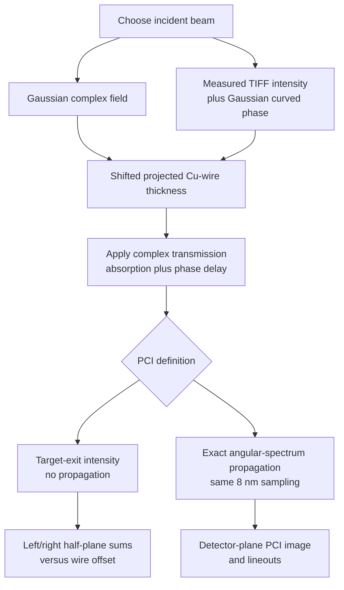
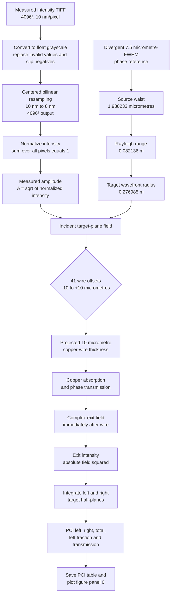

# Complete PCI calculation workflows

This document covers **all PCI calculations in the codebase**, not only the
realistic-profile notebook. It separates calculations that are sometimes
shown together but represent different physical planes:

1. propagated PCI from a Gaussian beam,
2. target-exit intensity scans used as a PCI proxy,
3. measured-TIFF target-exit PCI with Gaussian wavefront curvature, and
4. the Gaussian simulation/experiment comparison, and
5. the archived LightPipes and idealized Fresnel calculations.

The calculations share the same copper transmission model, but their source
fields, propagation algorithms, distances, and output sampling are not all the
same. These differences must be retained when comparing figures.

## Calculation-family map



## PCI families and numerical settings

| PCI family | Incident field | Target FWHM | PCI plane or distance | Propagator | Main use |
|---|---|---:|---:|---|---|
| Clean propagated PCI | Divergent Gaussian amplitude and phase | 7.5 micrometres | 6.31 m after target | Exact angular spectrum | Detector-plane phase-contrast image |
| Methods offset scan | Divergent Gaussian amplitude and phase | 6.0 micrometres | Immediately after target | None | Isolate left/right response to wire offset |
| Methods PCI/SAXS gallery | Gaussian beam for the selected divergence case | Case dependent | Immediately after target in the current gallery | None | Show target-exit attenuation beside SAXS |
| Realistic-profile PCI | Measured TIFF amplitude and 7.5-micrometre Gaussian phase curvature | Phase reference: 7.5 micrometres | Immediately after target | None | Left/right offset scan using measured illumination |
| Experimental-comparison PCI | Divergent Gaussian amplitude and phase | 7.5 micrometres | Immediately after target | None | Compare simulated total transmission with Zyla motor scan r0484 |


The target-exit calculations measure absorption and beam/wire overlap. A
detector-plane PCI calculation additionally converts target-induced phase into
intensity fringes during propagation. They should therefore be compared as
different observables, not as two implementations of the same image.

## Physics shared by every PCI family

### Photon wavelength and wavenumber

For photon energy \(E=8.2\ \mathrm{keV}\),

\[
\lambda = \frac{hc}{E}=0.15120024\ \mathrm{nm},
\qquad
k=\frac{2\pi}{\lambda}=41.55539\ \mathrm{nm^{-1}}.
\]

### Gaussian source construction

The Gaussian intensity convention is

\[
I(r,z)=I_{\mathrm{peak}}(z)
\exp\!\left[-\frac{2r^2}{w(z)^2}\right],
\qquad
\mathrm{FWHM}=w(z)\sqrt{2\ln 2}.
\]

For a target FWHM and source-to-target distance \(z=0.25\ \mathrm{m}\), the
waist \(w_0\) follows from

\[
w(z)^2=w_0^2+\left(\frac{\lambda z}{\pi w_0}\right)^2.
\]

This equation has a small-waist divergent root and a large-waist
quasi-collimated root. The roots used by the notebooks are:

| Target FWHM | Divergent/small root | Quasi-collimated/large root |
|---:|---:|---:|
| 6.0 micrometres | 2.846721 micrometres | 4.226664 micrometres |
| 7.5 micrometres | 1.988233 micrometres | 6.051671 micrometres |

The complex Gaussian field contains both amplitude and curvature phase,

\[
U_G(r,z)=\frac{w_0}{w(z)}
\exp\!\left[-\frac{r^2}{w(z)^2}\right]
\exp\!\left[-i\frac{kr^2}{2R(z)}+i\zeta(z)\right].
\]

Each simulation normalizes the incident intensity by its maximum, so its
peak equals 1 while the requested FWHM remains unchanged.

### Copper-wire target

The wire radius is 5 micrometres. A 20 nm voxel model is projected through the
wire to obtain the thickness map \(t(x,y)\). Its discretized centre thickness
is approximately 10.02 micrometres. At 8.2 keV the code uses

\[
\delta=2.35659\times10^{-5},\qquad
\beta=4.98858\times10^{-7},\qquad
\mu=2k\beta=4.09064\times10^{-5}\ \mathrm{nm^{-1}}.
\]

The target multiplies the incident complex field by

\[
T(x,y)=\exp[-\mu t(x,y)/2]\,
       \exp[-ik\delta t(x,y)],
\qquad U_{exit}=U_{in}T.
\]

The factor \(1/2\) appears in the amplitude attenuation; after taking
\(|U|^2\), the intensity attenuation is \(\exp(-\mu t)\).

## Family 1: clean detector-propagated Gaussian PCI

`SAXS_asymmetry/clean_pci_design.ipynb` uses a 4096 x 4096 grid with 8 nm
pixels, a divergent Gaussian with 7.5 micrometre target FWHM, and the
1.988233 micrometre small-root source waist. After applying the Cu target, it
propagates the exit field 6.31 m with the exact angular-spectrum method:

\[
U_z=\mathcal F^{-1}\left\{
\mathcal F[U_{exit}]\exp(i k_z z)
\right\},
\quad
k_z=\sqrt{k^2-k_x^2-k_y^2}.
\]

This method keeps the input and detector pixel spacing at 8 nm. Its output is
a true propagated PCI image containing near-field fringes. The grid field of
view is 32.768 micrometres.

## Family 2: Methods Gaussian target-exit scans

`SAXS_asymmetry/SAXS_Asymmetry_Methods.ipynb` uses the same 4096 x 4096,
8 nm grid and 0.25 m source-to-target distance, but the baseline Gaussian
target FWHM is 6.0 micrometres with a 2.846721 micrometre divergent waist.
The wire is translated transversely and the intensity is evaluated directly
after the target:

\[
I_{exit}(x,y;x_w)=|U_{in}(x,y)T(x-x_w,y)|^2.
\]

For every offset, the calculation integrates the left and right halves and
forms fractions such as

\[
f_L=\frac{P_L}{P_L+P_R},\qquad
f_R=1-f_L.
\]

Because no free-space propagation follows the target, these scans quantify
overlap and attenuation rather than propagation-generated phase contrast.
The notebook also studies 9 and 12 micrometre target spots and includes a
12 micrometre large-root, quasi-collimated case.

## Family 3: realistic measured-profile target-exit PCI

`SAXS_asymmetry/realistic_profile_saxs_pci_design.ipynb` keeps the measured
TIFF intensity, rescales it from 10 nm to the 8 nm simulation grid, and uses
only the curved phase of the 7.5 micrometre divergent Gaussian. This branch is
described numerically and step by step in the remainder of this document.

## Family 4: Gaussian simulation/experiment comparison

`SAXS_asymmetry/SAXS_PCI_Experimental_Comparison.ipynb` uses a divergent
7.5 micrometre Gaussian on the 4096 x 4096, 8 nm grid. Its PCI observable is
again the total sample-exit intensity, not a propagated detector image. It
uses an analytic cylindrical chord for the PCI/transmission path, scans image
offsets from -10 to +10 micrometres in 2.5 micrometre steps, and evaluates the
transmission comparison on 49 offsets from -12 to +12 micrometres. Simulated
and experimental r0484 transmission are each normalized by their own maximum
because no absolute intensity calibration is applied.

## Family 5: archived LightPipes and idealized PCI

`SAXS_asymmetry/SAXS_PCI_Pointing_Div.ipynb` reconstructs historical PCI with
LightPipes Fresnel propagation. The source and voxelized Cu interaction are
conceptually the same, but the propagation and array conventions differ from
the current exact angular-spectrum path. The archived figures can also contain
legacy TIFF-axis or mirror conventions. Use this branch for reproduction; use
the clean angular-spectrum branch for a controlled new detector-PCI study.

`SAXS_asymmetry/idealc.ipynb` is a separate idealized calculation. Its active
configuration uses a 2048 x 2048 array, 8.2 keV photons, a 10 micrometre
Gaussian FWHM, a 10 micrometre analytic Cu chord, 6.31 m propagation, and a
1.625 micrometre far-plane pixel. The corresponding source-plane sampling is
derived from \(\Delta x=\lambda z/(N\Delta X)\), approximately 286.7 nm. It
uses historical Cu constants \(\mu=1/(26.05\ \mathrm{micrometres})\) and
\(\delta=2.1401\times10^{-5}\), so it is not numerically interchangeable with
the current 20 nm voxel/material model.

## Detailed realistic-profile target-exit PCI calculation

## Numerical configuration

| Quantity | Value |
|---|---:|
| Photon energy | 8.2 keV |
| Wavelength | 0.15120024 nm |
| Wavenumber | 41.55539 nm^-1 |
| Native TIFF | 4096 x 4096 pixels |
| Native TIFF pixel size | 10 nm |
| Native field of view | 40.96 micrometres |
| Simulation grid | 4096 x 4096 pixels |
| Simulation pixel size | 8 nm |
| Simulation field of view | 32.768 micrometres |
| Curvature reference FWHM at target | 7.5 micrometres |
| Curvature source-to-target distance | 0.25 m |
| Copper-wire radius | 5 micrometres |
| Copper-wire diameter | 10 micrometres |
| Wire voxel size | 20 nm |
| Wire projection grid | 2000 x 2000 voxels |
| Wire projection field of view | 40 micrometres |
| Wire offsets | -10 to +10 micrometres |
| Offset step | 0.5 micrometres |
| Number of offsets | 41 |

## Workflow diagram



## 1. Load and resample the measured intensity

The input image is:

```text
SAXS_asymmetry/inputs/profiles/RealisticProfile_10nm.tif
```

It is converted to a floating-point grayscale array. Invalid values are
replaced by zero and negative values are clipped to zero.

The native image is sampled at 10 nm per pixel. The PCI grid is sampled at
8 nm per pixel, so the output-to-input index scale is

```text
8 / 10 = 0.8.
```

The image is bilinearly resampled about the common array centre. The number of
pixels remains 4096 in each direction, so the field of view decreases from

```text
4096 x 10 nm = 40.96 micrometres
```

to

```text
4096 x 8 nm = 32.768 micrometres.
```

The measured physical intensity retained by this centred crop is
0.99999811, or approximately 99.999811 percent.

## 2. Normalize the measured intensity

The resampled intensity is normalized by its discrete pixel sum:

```math
I_{\mathrm{incident}}(x,y)
=
\frac{I_{\mathrm{raw}}(x,y)}
{\sum_{x,y} I_{\mathrm{raw}}(x,y)}.
```

Consequently,

```math
\sum_{x,y} I_{\mathrm{incident}}(x,y)=1.
```

The measured field amplitude is

```math
A_{\mathrm{TIFF}}(x,y)=\sqrt{I_{\mathrm{incident}}(x,y)}.
```

No Gaussian amplitude envelope replaces or multiplies this measured
intensity profile.

## 3. Calculate and apply the curved phase

The TIFF contains intensity but no phase map. The workflow therefore uses the
wavefront curvature of a divergent Gaussian reference with a 7.5 micrometre
target-plane intensity FWHM.

The corresponding 1/e^2 intensity radius is

```math
w_t
=
\frac{7.5\ \mathrm{micrometres}}{\sqrt{2\ln 2}}
=6.3699\ \mathrm{micrometres}.
```

For wavelength `lambda` and distance `z`, Gaussian spreading obeys

```math
w_t^2=w_0^2+\left(\frac{\lambda z}{\pi w_0}\right)^2.
```

Using the smaller, divergent root gives

```math
w_0=1.988233\ \mathrm{micrometres}.
```

The Rayleigh range and target wavefront radius are

```math
z_R=\frac{\pi w_0^2}{\lambda}=0.0821357\ \mathrm{m},
```

```math
R(z)=\frac{z^2+z_R^2}{z}=0.276985\ \mathrm{m}.
```

The incident complex field is

```math
E_{\mathrm{in}}(x,y)
=
\sqrt{I_{\mathrm{incident}}(x,y)}
\exp\left[-\frac{i k}{2R}(x^2+y^2)\right],
```

where

```math
k=\frac{2\pi}{\lambda}=41.55539\ \mathrm{nm}^{-1}.
```

The implemented curvature agrees with `PCI.gaussian_XFEL` to approximately
1.1e-11 radians after removal of its irrelevant global phase.

## 4. Build the projected copper wire

The ideal projected thickness of a cylindrical wire is

```math
t(x)=
\begin{cases}
2\sqrt{r^2-x^2}, & |x|\le r,\\
0, & |x|>r.
\end{cases}
```

The numerical radius is

```text
5000 nm / 20 nm = 250 voxels.
```

The discrete implementation uses

```math
t_i=
\left(2\left\lfloor\sqrt{250^2-i^2}\right\rfloor+1\right)
(20\ \mathrm{nm}).
```

This gives a centre thickness of approximately

```text
501 x 20 nm = 10020 nm.
```

The projection is shifted to each configured wire offset using bilinear
interpolation.

## 5. Apply copper absorption and phase

At 8.2 keV, the implemented copper material has approximately

```math
\delta=2.35659\times10^{-5},
```

```math
\beta=4.98858\times10^{-7}.
```

The code's amplitude-attenuation coefficient is

```math
\mu=4.09064\times10^{-5}\ \mathrm{nm}^{-1}
=0.0409064\ \mathrm{micrometre}^{-1}.
```

`PCI.py` prints this value with a `[1/um]` label, but its projected target
thickness is represented in nanometres. The operational coefficient is
therefore per nanometre.

The phase coefficient is

```math
k\delta=9.79289\times10^{-4}\ \mathrm{rad\,nm}^{-1}.
```

The wire field transmission is

```math
T(x,y)
=
\exp\left[-\frac{\mu t(x,y)}{2}\right]
\exp\left[-i k\delta t(x,y)\right].
```

The field immediately after the wire is

```math
E_{\mathrm{exit}}(x,y)=E_{\mathrm{in}}(x,y)T(x,y).
```

At the discretized wire centre, where the thickness is approximately
10020 nm:

| Quantity | Approximate value |
|---|---:|
| Field-amplitude transmission | 0.8147 |
| Intensity transmission | 0.6637 |
| Unwrapped copper phase shift | 9.8125 rad |

## 6. Calculate the PCI signals

The exit-plane PCI intensity is

```math
I_{\mathrm{PCI}}(x,y)=|E_{\mathrm{exit}}(x,y)|^2.
```

The left and right signals are discrete half-plane sums:

```math
L_{\mathrm{PCI}}=\sum_{x<0,y}I_{\mathrm{PCI}}(x,y),
```

```math
R_{\mathrm{PCI}}=\sum_{x>0,y}I_{\mathrm{PCI}}(x,y).
```

The on-axis column is split equally between the two sides. The reported left
fraction is

```math
F_{\mathrm{PCI}}
=
\frac{L_{\mathrm{PCI}}}
{L_{\mathrm{PCI}}+R_{\mathrm{PCI}}}.
```

Because the incident discrete intensity sum is one, the transmitted fraction
is

```math
T_{\mathrm{PCI}}
=L_{\mathrm{PCI}}+R_{\mathrm{PCI}}.
```

A common pixel-area factor is not required for these fractions.

## 7. Regenerated results

At zero wire offset:

| Quantity | Value |
|---|---:|
| PCI left | 0.36814453 |
| PCI right | 0.35892973 |
| PCI total | 0.72707427 |
| PCI left fraction | 0.50633690 |
| Total exit / incident | 0.72707427 |

Across the full 41-offset scan:

| Quantity | Minimum | Maximum |
|---|---:|---:|
| PCI left fraction | 0.431984 | 0.586101 |
| Total exit / incident | 0.727074 | 0.994099 |

## Outputs

- Figure: `SAXS_asymmetry/outputs/realistic_profile/figures/01_realistic_pci_saxs_left_right.png`
- PCI table: `SAXS_asymmetry/outputs/realistic_profile/tables/realistic_profile_pci_exit_left_right.dat`

The PCI table columns are:

```text
offset_um
left_exit_raw
right_exit_raw
total_exit_raw
left_over_left_plus_right
total_exit_over_incident
```
