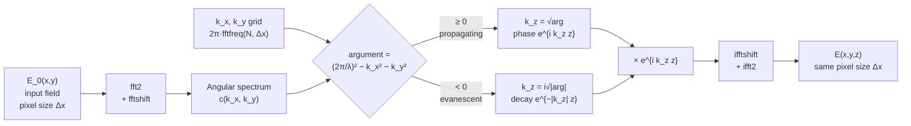
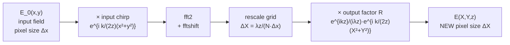
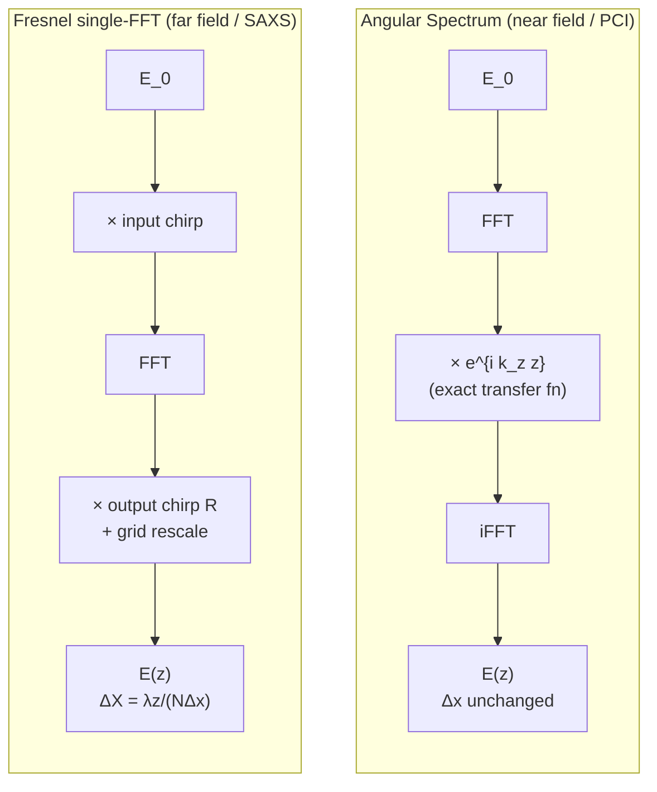
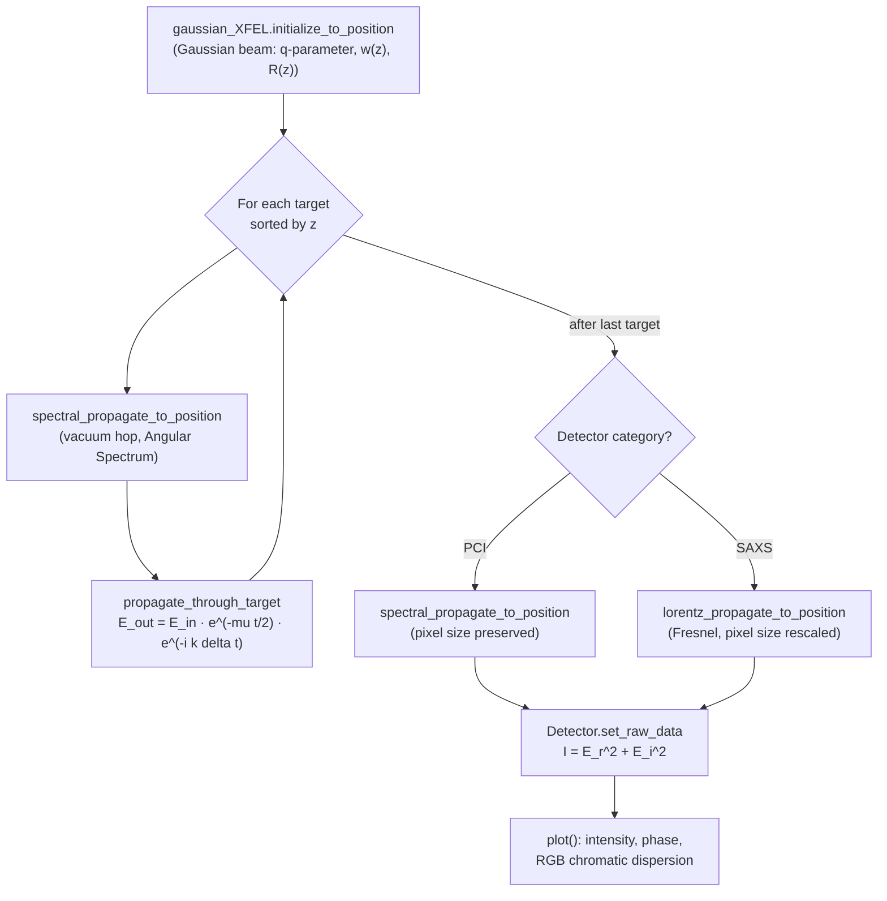
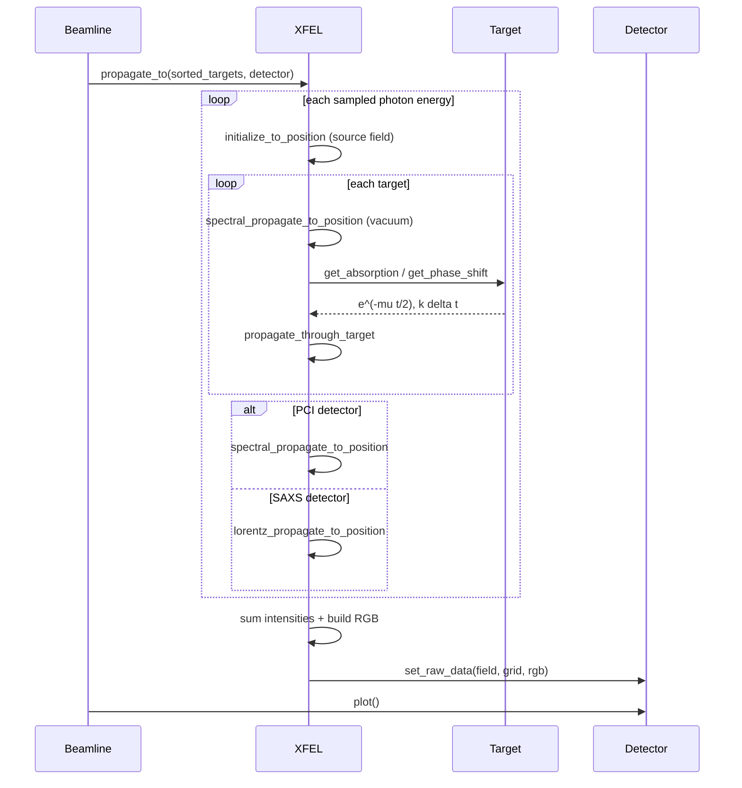

# HRXP Propagator Math

This document explains the wave-optics propagators implemented in `PCI.py`, the
physics they encode, and how they map onto the source code. All quantities use
the module unit system: **length in nanometers** (`nm = 1`) and **energy in keV**.

---

## 1. Conventions and base quantities

The field is a scalar, monochromatic, complex wavefield in a transverse plane:

$$E(x, y) = E_r(x, y) + i\,E_i(x, y) = A(x,y)\, e^{i\phi(x,y)}$$

stored as `self._realPart` and `self._imagPart`.

| Symbol | Meaning | Code |
| --- | --- | --- |
| $k$ | wavenumber $2\pi/\lambda$ | `get_k()` → `5.06773076 * E[keV]` |
| $\lambda$ | wavelength | `get_lambda()` → `2π/k` |
| $\delta$ | refractive index decrement | `get_n_refraction_delta()` |
| $\beta$ | absorption index | `get_n_refraction_beta()` |
| $t(x,y)$ | projected target thickness | `_get_projection()` |

The relation $k = 5.06773076\,E[\text{keV}]$ comes from
$k = 2\pi/\lambda$ with $\lambda[\text{nm}] = 1.239842 / E[\text{keV}]$, so
$k = 2\pi \cdot E / 1.239842 = 5.0677\,E$ per nm.

The complex refractive index is

$$n = 1 - \delta - i\beta$$

with

$$\delta = 0.933386 \; N_a\, \rho\, \frac{Z}{A}\, r_e \, \frac{\lambda^2}{2\pi},
\qquad
\beta = \frac{\mu_1\,\rho}{E^{\mu_2}}.$$

The leading `0.933386` is an empirical Henke-data correction (flagged in the
source as "needs to be checked").

---

## 2. Interaction with a target (thin / projection approximation)

A target is treated as an infinitely thin phase-and-amplitude screen at its
$z$ position. The outgoing field is the incoming field multiplied by a complex
transmission:

$$E_{\text{out}}(x,y) = E_{\text{in}}(x,y)\;
\underbrace{e^{-\frac{1}{2}\mu\, t(x,y)}}_{\text{amplitude transmission}}\;
\underbrace{e^{-i\,\Delta\phi(x,y)}}_{\text{phase shift}}$$

### Amplitude (absorption)
`Target.get_absorption()` returns the **field** transmission (note the factor
$\tfrac{1}{2}$ — intensity goes as $e^{-\mu t}$, amplitude as $e^{-\mu t/2}$):

$$T_{\text{field}} = e^{-\frac{1}{2}\mu\, t}, \qquad \mu = \beta \cdot E \cdot 10 \;\; [\mu\text{m}^{-1}]$$

### Phase
`Material._get_phase_shift()` gives the per-length phase, multiplied by the
projected thickness in `Target.get_phase_shift()`:

$$\Delta\phi(x,y) = k\,\delta\, t(x,y) = \frac{2\pi}{\lambda}\,\delta\, t(x,y)$$

### In code (`propagate_through_target`)
```text
transmission     = interpolate( target.get_absorption )      # e^{-mu t /2}
E0               = |field_in|
transmitted_E0   = E0 * transmission
beamPhase        = angle(field_in)
dPhi             = interpolate( target.get_phase_shift )      # k delta t
beamPhase        = beamPhase - dPhi
wave_at_contact  = transmitted_E0 * (cos(beamPhase) + i sin(beamPhase))
```

The target grid (voxel size) is resampled onto the beam grid (pixel size) by
`_interpolate_target2beam()` using a `RectBivariateSpline`.

---

## 3. Angular Spectrum propagator (near field, exact)

Implemented in `spectral_propagate_to_position()`. Used for **PCI** and for the
target-to-target hops. This is the exact solution of the Helmholtz equation in
free space and **preserves the pixel size**.

### Derivation
Decompose the field into plane waves (the angular spectrum) via 2D Fourier
transform:

$$\tilde{E}_0(k_x, k_y) = \mathcal{F}\{E_0(x,y)\}$$

Each plane-wave component propagates a distance $z$ by acquiring a phase
$e^{i k_z z}$, where the dispersion relation fixes $k_z$:

$$k_z = \sqrt{\left(\frac{2\pi}{\lambda}\right)^2 - k_x^2 - k_y^2}$$

The propagated field is the inverse transform:

$$\boxed{\,E(x,y,z) = \mathcal{F}^{-1}\!\left\{ \mathcal{F}\{E_0\}\;
e^{\,i k_z z} \right\}\,}$$

### Evanescent modes
When $k_x^2 + k_y^2 > (2\pi/\lambda)^2$ the argument under the root is negative
and $k_z$ becomes **imaginary**, giving exponential decay $e^{-|k_z| z}$. The
code handles both branches explicitly:

```python
argument = (2*np.pi/Lambda)**2 - kx**2 - ky**2
tmp = np.sqrt(np.abs(argument))
kz  = np.where(argument >= 0, tmp, j*tmp)   # propagating vs evanescent
cc  = ifftshift(c * np.exp(j * kz * Z))
E_new = ifft2(cc)
```

### Properties
- **Exact** (no paraxial approximation) — valid in near and far field.
- **Pixel size unchanged**: output sampling = input sampling.
- Best for short propagation where the beam stays inside the window — ideal for
  phase-contrast fringe formation.

### Algorithm diagram



The transfer function $H = e^{i k_z z}$ is a **pure phase** for propagating
modes (energy-conserving) and a **real decay** for evanescent modes. The grid
spacing never changes, so successive hops compose cleanly.

---

## 4. Fresnel single-FFT propagator (far field, magnifying)

Implemented in `lorentz_propagate_to_position()`. Used for **SAXS** (detector
far from the last target). This is the paraxial (Fresnel) approximation
evaluated with a **single** Fourier transform, which **rescales the pixel size**.

### Derivation
The Fresnel diffraction integral is

$$E(X,Y,z) = \frac{e^{ikz}}{i\lambda z}
\iint E_0(x,y)\,
e^{\,i\frac{k}{2z}\left[(X-x)^2 + (Y-y)^2\right]}\, dx\, dy.$$

Expanding the quadratic and separating terms that do/do not depend on the
integration variables gives the **single-FFT** form:

$$E(X,Y,z) = \frac{e^{ikz}}{i\lambda z}\,
e^{\,i\frac{k}{2z}(X^2+Y^2)}\;
\mathcal{F}\!\left\{ E_0(x,y)\, e^{\,i\frac{k}{2z}(x^2+y^2)} \right\}$$

The input chirp $e^{ik(x^2+y^2)/2z}$ is applied, then one FFT, then the output
quadratic phase factor $R$.

### Pixel-size rescaling
Because the FFT maps the input plane directly to the diffraction plane, the
output pixel size is set by the transform geometry:

$$\Delta X = \frac{2\pi z}{k\,N\,\Delta x} = \frac{\lambda z}{N\,\Delta x}$$

In code:
```python
new_pixel_size = Z * 2*np.pi / (k * old_pixel_number * old_pixel_size)
E = fft2( E * np.exp(j*(k/(2*Z)*(self._x**2 + self._y**2))) )   # input chirp
X, Y = self._define_image_scale(pixel_size=new_pixel_size)      # rescaled grid
R = np.exp(j*k*Z)/(j*Lambda*Z) * np.exp(j*k/(2*Z)*(X**2 + Y**2))# output chirp
E = R * fftshift(E)
```

> Note: the source flags a possible missing factor of 2 in `new_pixel_size`
> (`Lingen lost of a factor of 2 ?`). Worth validating against a known SAXS
> reference pattern, since it directly scales the q-axis calibration.

### Properties
- **Paraxial** (small-angle) approximation — valid only in the far field.
- **Pixel size changes** with $z$ — magnifying coordinate system; the new axis
  is exported as `new_x_plot` / `new_pixel_size`.
- Efficient single FFT for large detector distances.

### Algorithm diagram



Unlike the angular-spectrum method, the single FFT maps the **input plane**
directly to the **diffraction plane**, so the output coordinates $X, Y$ are
stretched by the factor $\lambda z/(N\Delta x)$. The two quadratic-phase
("chirp") factors bracket the transform: one before (input curvature) and one
after (output curvature).

---

## 5. Choosing a propagator

| Regime | Propagator | Method | Pixel size | Code |
| --- | --- | --- | --- | --- |
| Near field / PCI | Angular Spectrum | $\mathcal{F}^{-1}[\mathcal{F}E_0\,e^{ik_z z}]$ | preserved | `spectral_propagate_to_position` |
| Far field / SAXS | Fresnel single-FFT | chirp · FFT · chirp | rescaled | `lorentz_propagate_to_position` |

`propagate_to()` selects automatically: PCI detectors (or no detector) use the
spectral propagator for the final hop; SAXS detectors use the Lorentz/Fresnel
propagator (and ignore the spectral bandwidth).

### Side-by-side comparison



| | Angular Spectrum | Fresnel single-FFT |
| --- | --- | --- |
| FFTs | 2 (forward + inverse) | 1 (forward only) |
| Approximation | none (exact) | paraxial |
| Transfer function | $e^{i k_z z}$ | input + output chirps |
| Output grid | same $\Delta x$ | rescaled $\Delta X$ |
| Evanescent waves | yes | no |
| Use case | PCI, target hops | SAXS far field |

---

## 6. Polychromatic (bandwidth) propagation

For a finite spectral width, `propagate_to()` samples a Gaussian energy profile

$$w(E) = 0.5^{\,2(E-E_0)^2/\text{FWHM}^2}$$

propagates **each energy independently** (optionally in parallel via
`multiprocessing.Pool`), sums the resulting intensities, and assigns each energy
an RGB weight to render chromatic dispersion. Both $\delta$ and the diffraction
angle scale with $\lambda$, so different colors focus and diffract differently.

---

## 7. Full propagation pipeline



### Sequence of a `Beamline.propagate_XFEL_to(detector)` call



---

## 8. Quick reference — equations to code

| Physics | Equation | Function |
| --- | --- | --- |
| Wavenumber | $k = 2\pi/\lambda$ | `get_k` |
| Phase decrement | $\delta \propto N_a \rho \frac{Z}{A} r_e \lambda^2$ | `get_n_refraction_delta` |
| Absorption | $\beta = \mu_1 \rho / E^{\mu_2}$ | `get_n_refraction_beta` |
| Target phase | $\Delta\phi = k\,\delta\, t$ | `get_phase_shift` |
| Target amplitude | $T = e^{-\mu t/2}$ | `get_absorption` |
| Angular spectrum | $E = \mathcal{F}^{-1}[\mathcal{F}E_0\, e^{ik_z z}]$ | `spectral_propagate_to_position` |
| Fresnel single-FFT | $E = \frac{e^{ikz}}{i\lambda z} e^{i\frac{k}{2z}r^2}\mathcal{F}[E_0 e^{i\frac{k}{2z}r^2}]$ | `lorentz_propagate_to_position` |
| Gaussian beam | $q(z),\ w(z),\ R(z),\ z_R=\pi w_0^2/\lambda$ | `initialize_to_position` |

