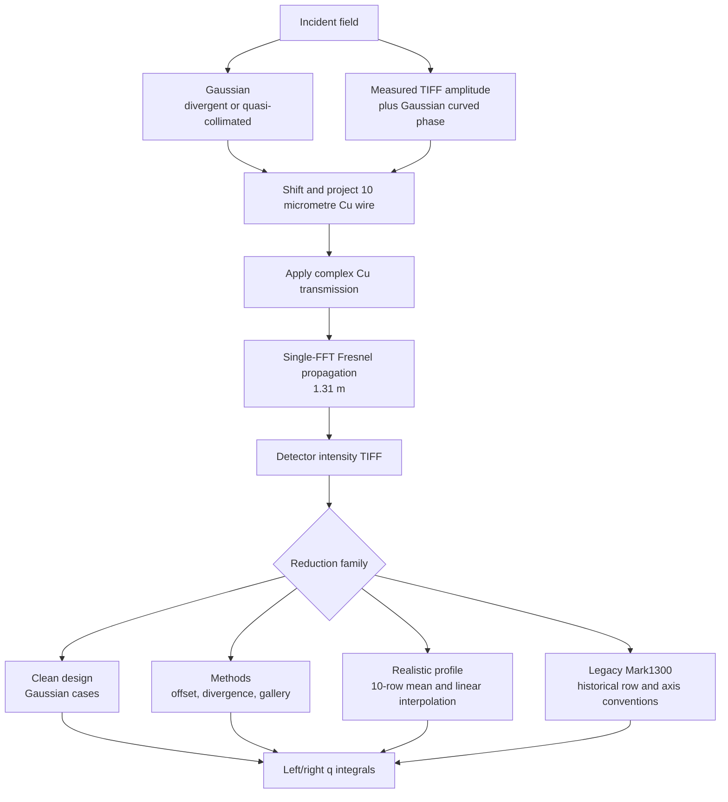
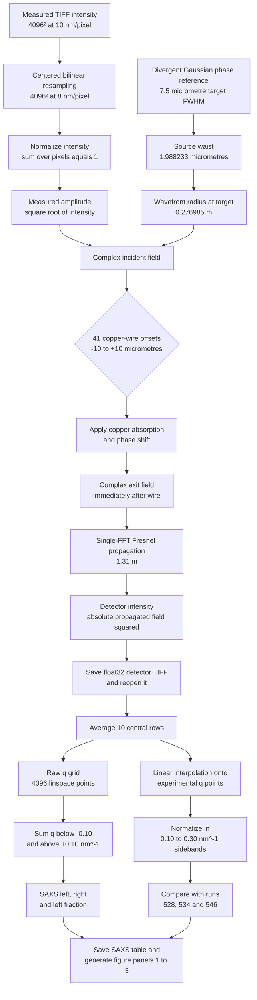

# Complete SAXS calculation workflows

This document covers **all SAXS calculations in the codebase**, including the
clean Gaussian designs, the three analyses in `SAXS_Asymmetry_Methods`, the
Gaussian experimental-comparison notebook, the measured realistic profile,
and the archived Mark1300-compatible workflow.
It records the numerical settings and the reduction choices that can change
the apparent left/right asymmetry.

## Calculation-family map



## SAXS families and numerical settings

| SAXS family | Incident field | Target FWHM | Detector propagation | Lineout/regridding | Main purpose |
|---|---|---:|---:|---|---|
| Clean Gaussian design | Four Gaussian amplitude-and-phase cases | 6.0 or 7.5 micrometres | 1.31 m single-FFT Fresnel | Current notebook reduction | Controlled divergence comparison |
| Methods: offset scan | Divergent Gaussian | 6.0 micrometres baseline | 1.31 m | 10-row display lineout; Mark1300 asymmetry uses 2 central rows | Wire-position asymmetry |
| Methods: divergence scan | Divergent 6, 9, 12 micrometres plus 12 micrometre quasi-collimated case | Case dependent | 1.31 m | Same Methods reduction | Separate spot size and curvature effects |
| Methods: PCI/SAXS gallery | Selected Gaussian cases | Case dependent | 1.31 m for SAXS | Detector images and central profiles | Visual comparison of target exit and far field |
| Experimental comparison | Divergent Gaussian | 7.5 micrometres | 1.31 m | Validated experimental profiles plus simulated detector images | Compare SAXS reference metrics and target-exit transmission |
| Realistic-profile SAXS | Measured TIFF amplitude plus divergent 7.5-micrometre Gaussian phase | Phase reference: 7.5 micrometres | 1.31 m | 10-row mean, explicit linear interpolation to experimental q | Measured incident-beam study |
| Archived Mark1300 workflow | Gaussian source and voxelized Cu wire | Notebook dependent | Legacy Fresnel/Lorentz path | Historical row, q-axis, and TIFF conventions | Reproduce old results |

## Physics shared by every SAXS family

### Source, material, and simulation grid

Unless a notebook explicitly overrides a setting, the current SAXS designs use:

| Quantity | Value |
|---|---:|
| Photon energy | 8.2 keV |
| Wavelength | 0.15120024 nm |
| Wavenumber | 41.55539 nm^-1 |
| Simulation array | 4096 x 4096 |
| Target-plane pixel size | 8 nm |
| Target-plane field of view | 32.768 micrometres |
| Source-to-target distance | 0.25 m |
| Cu-wire radius | 5 micrometres |
| Wire voxel size | 20 nm |
| Target-to-detector distance | 1.31 m |

The Gaussian convention and source-waist solutions are:

| Target FWHM | Divergent/small root | Quasi-collimated/large root |
|---:|---:|---:|
| 6.0 micrometres | 2.846721 micrometres | 4.226664 micrometres |
| 7.5 micrometres | 1.988233 micrometres | 6.051671 micrometres |

For each Gaussian case, the peak incident intensity is normalized to 1. This
changes only the common intensity scale; it does not change FWHM or curvature.
The realistic branch instead keeps the measured spatial intensity shape and
normalizes its peak to 1, while taking phase curvature from the 7.5 micrometre
divergent reference.

### Copper transmission

All current workflows calculate projected thickness \(t(x,y)\), shift it by
the requested wire offset, and apply

\[
U_{exit}=U_{in}
\exp[-\mu t/2]
\exp[-ik\delta t],
\]

with

\[
\delta=2.35659\times10^{-5},\quad
\beta=4.98858\times10^{-7},\quad
\mu=4.09064\times10^{-5}\ \mathrm{nm^{-1}}.
\]

At the wire centre, the 20 nm discretization produces approximately
10.02 micrometres of Cu thickness.

### Single-FFT Fresnel propagation

The current SAXS notebooks use the scaled single-FFT Fresnel form implemented
by the Lorentz/Fresnel propagator. In compact form,

\[
U_D(X,Y)=\frac{e^{ikD}}{i\lambda D}
e^{i\frac{k}{2D}(X^2+Y^2)}
\mathcal F\left\{
U_{exit}(x,y)e^{i\frac{k}{2D}(x^2+y^2)}
\right\}.
\]

Its detector sampling is not 8 nm. It is

\[
\Delta X=\frac{\lambda D}{N\Delta x}
=6.04469\ \mathrm{micrometres},
\]

so the 4096-pixel detector field of view is about 24.7590 mm.

## Family 1: clean Gaussian SAXS designs

`SAXS_asymmetry/clean_saxs_design.ipynb` constructs four controlled beams:

| Case | Target FWHM | Waist root | Source waist |
|---|---:|---|---:|
| Divergent 6.0 | 6.0 micrometres | Small | 2.846721 micrometres |
| Divergent 7.5 | 7.5 micrometres | Small | 1.988233 micrometres |
| Quasi-collimated 6.0 | 6.0 micrometres | Large | 4.226664 micrometres |
| Quasi-collimated 7.5 | 7.5 micrometres | Large | 6.051671 micrometres |

Every case applies the same Cu target and 1.31 m Fresnel propagation. Therefore
differences in its SAXS curves can be attributed to spot size and wavefront
curvature rather than to a different material or propagation model.

## Family 2: `SAXS_Asymmetry_Methods` analyses

`SAXS_asymmetry/SAXS_Asymmetry_Methods.ipynb` contains three related studies:

1. transverse wire offset in the 6 micrometre divergent beam,
2. divergence/spot-size dependence using 6, 9, and 12 micrometre cases plus a
   12 micrometre large-root reference, and
3. a target-exit PCI and detector-SAXS image gallery.

The baseline grid is 4096 x 4096 at 8 nm, with the target 0.25 m from the
Gaussian waist and the SAXS plane 1.31 m after the target. The displayed SAXS
lineout averages 10 detector rows. The Mark1300-style asymmetry calculation in
this notebook uses two central rows and excludes the central region associated
with \(|q|<0.1\ \mathrm{nm^{-1}}\). With the FFT spacing

\[
\Delta q=\frac{2\pi}{N\Delta x}=1.91748\times10^{-4}\ \mathrm{nm^{-1}},
\]

the excluded half-width is approximately 522 pixels. The plotted comparison
to runs 528, 534, and 546 uses run-specific display multipliers of
\(5.0\times10^4\), \(8.0\times10^4\), and \(8.0\times10^4\), respectively.
These multipliers affect plotted amplitude but not the left/right fraction.

## Family 3: Gaussian simulation/experiment comparison

`SAXS_asymmetry/SAXS_PCI_Experimental_Comparison.ipynb` uses a divergent
7.5 micrometre Gaussian, 4096 x 4096 points, 8 nm target pixels, a 0.25 m
source-to-wire distance, and 1.31 m SAXS propagation. Its SAXS path uses the
same 20 nm voxelized wire and `PCI.py` interpolation as the clean design. It
loads cleaned experimental SAXS payloads for runs 528, 534, and 546, preserves
each run's native signed-q values, and reports left fraction, weighted RMS,
unweighted RMS, and fitted centre. It does not force all experimental runs
onto one common q grid for these reference metrics.

The same notebook makes detector images at nine wire offsets from -10 to
+10 micrometres in 2.5 micrometre steps. Its parallel PCI calculation is
sample-exit intensity, and its transmission scan uses 49 points from -12 to
+12 micrometres for comparison with the r0484 Zyla motor scan.

## Family 4: realistic measured-profile SAXS

`SAXS_asymmetry/realistic_profile_saxs_pci_design.ipynb` uses measured TIFF
intensity for the target-plane amplitude and the 7.5 micrometre divergent
Gaussian only for phase curvature. It propagates every one of 41 wire offsets
from -10 to +10 micrometres in 0.5 micrometre steps. The detector lineout is
the mean of 10 central rows. The notebook now defines the raw axis explicitly
as

```python
q_raw = np.linspace(-Q_MAX, Q_MAX, 4096)
```

and uses linear interpolation onto each experimental q array. The detailed
steps and numerical results are given in the remainder of this document.

## Family 5: archived Mark1300-compatible SAXS

`SAXS_asymmetry/SAXS_PCI_Pointing_Div.ipynb` and
`SAXS_asymmetry/PlotSAXS_Pointing_Div.ipynb` use the historical Gaussian plus
voxelized-Cu model and the legacy Fresnel/Lorentz pipeline. They are useful for
reproducing earlier Mark1300 plots. However, old TIFF handling can include
axis transposition or mirroring conventions, and its lineout width, central
mask, q construction, and display scaling must be matched before a numerical
comparison. For new comparisons, prefer regenerating both cases with one
shared reduction function.

The plotting notebook reads stored TIFFs, averages two central rows, and its
active historical left/right extraction excludes 1040 centre pixels per side.
That choice is not the same as the current \(|q|<0.1\ \mathrm{nm^{-1}}\)
mask, which evaluates to about 522 pixels on the current 4096-point, 8 nm grid.

## Reduction choices that must match in a before/after comparison

| Choice | Why it changes the result |
|---|---|
| Incident intensity profile | Changes how strongly each side of the wire is illuminated |
| Gaussian root | Changes wavefront curvature even at the same target FWHM |
| Detector propagation | Converts phase into detector intensity and sets output sampling |
| Number of averaged rows | Controls speckle/fringe vibration in the one-dimensional curve |
| Raw q convention | Can shift or stretch sampled points by a fraction of a bin |
| Central q exclusion | Changes which strong central features enter left/right sums |
| Interpolation versus bin averaging | Linear interpolation samples the curve; binning smooths it |
| Independent normalization | Hides absolute-flux changes and should be reported explicitly |
| TIFF orientation | A transpose or mirror can swap the physical left and right sides |

## Detailed realistic-profile SAXS calculation

## Numerical configuration

| Quantity | Value |
|---|---:|
| Photon energy | 8.2 keV |
| Wavelength | 0.15120024 nm |
| Wavenumber | 41.55539 nm^-1 |
| Native TIFF | 4096 x 4096 pixels |
| Native TIFF pixel size | 10 nm |
| Simulation grid | 4096 x 4096 pixels |
| Simulation pixel size | 8 nm |
| Simulation field of view | 32.768 micrometres |
| Incident phase-reference FWHM | 7.5 micrometres |
| Phase-reference source waist | 1.988233 micrometres |
| Target wavefront radius | 0.276985 m |
| Copper-wire radius | 5 micrometres |
| Target-to-detector distance | 1.31 m |
| Fresnel detector pixel size | 6.04469 micrometres |
| Fresnel detector field of view | 24.7590 mm |
| Wire offsets | -10 to +10 micrometres |
| Offset step | 0.5 micrometres |
| Number of offsets | 41 |
| Detector rows averaged | 10 central rows |
| Raw q range | -0.392699 to +0.392699 nm^-1 |
| Raw q spacing | 0.0001917944 nm^-1 |
| Excluded central band | abs(q) less than 0.10 nm^-1 |
| Profile-comparison range | abs(q) at most 0.30 nm^-1 |
| Experimental q spacing | 0.004 nm^-1 |

## Workflow diagram



## 1. Construct the incident field

The measured intensity is read from

```text
SAXS_asymmetry/inputs/profiles/RealisticProfile_10nm.tif
```

and resampled from 10 nm to 8 nm pixels on a centred 4096 x 4096 grid. The
output field of view is

```text
4096 x 8 nm = 32.768 micrometres.
```

The discrete intensity is normalized to one:

```math
I_{\mathrm{incident}}(x,y)
=
\frac{I_{\mathrm{raw}}(x,y)}
{\sum_{x,y}I_{\mathrm{raw}}(x,y)}.
```

The measured amplitude is

```math
A_{\mathrm{TIFF}}(x,y)=\sqrt{I_{\mathrm{incident}}(x,y)}.
```

The applied target-plane phase is

```math
\phi_{\mathrm{curve}}(x,y)
=
-\frac{k}{2R}(x^2+y^2),
```

where

```text
k = 41.55539 nm^-1
R = 0.276985 m.
```

Therefore,

```math
E_{\mathrm{in}}(x,y)
=
\sqrt{I_{\mathrm{incident}}(x,y)}
\exp\left[-\frac{i k}{2R}(x^2+y^2)\right].
```

The realistic measured amplitude is retained. Only the phase comes from the
Gaussian reference.

## 2. Apply the copper-wire transmission

The wire radius is 5 micrometres, giving an ideal projected thickness

```math
t(x)=2\sqrt{r^2-x^2}
```

inside the wire. The numerical target uses 20 nm voxels and a 2000 x 2000
projection map. Its discretized centre thickness is approximately 10020 nm.

At 8.2 keV, the implemented copper coefficients are approximately

```math
\delta=2.35659\times10^{-5},
```

```math
\mu=4.09064\times10^{-5}\ \mathrm{nm}^{-1},
```

```math
k\delta=9.79289\times10^{-4}\ \mathrm{rad\,nm}^{-1}.
```

The field transmission is

```math
T(x,y)
=
\exp\left[-\frac{\mu t(x,y)}{2}\right]
\exp\left[-i k\delta t(x,y)\right].
```

The field immediately after the wire is

```math
E_{\mathrm{exit}}(x,y)
=E_{\mathrm{in}}(x,y)T(x,y).
```

This calculation is repeated for 41 wire positions from -10 to +10
micrometres in 0.5 micrometre steps.

## 3. Fresnel propagation to the SAXS detector

The exit field is propagated over

```text
Z = 1.31 m = 1.31e9 nm
```

using the single-FFT Fresnel propagator. The implemented field is proportional
to

```math
E_D(X,Y)
\propto
\frac{e^{ikZ}}{i\lambda Z}
\exp\left[\frac{i k}{2Z}(X^2+Y^2)\right]
\mathcal{F}\left\{
E_{\mathrm{exit}}(x,y)
\exp\left[\frac{i k}{2Z}(x^2+y^2)\right]
\right\}.
```

The detector intensity is

```math
I_D(X,Y)=|E_D(X,Y)|^2.
```

The Fresnel transform changes the output-plane pixel size to

```math
\Delta X
=
\frac{\lambda Z}{N\Delta x}
=6.04469\ \mathrm{micrometres}.
```

The detector field of view is

```math
4096(6.04469\ \mathrm{micrometres})
=24.7590\ \mathrm{mm}.
```

For every wire offset, the detector intensity is converted to float32, saved
as a deflate-compressed TIFF, and reopened before analysis.

## 4. Extract the central SAXS lineout

For a 4096-row detector, the central row index is

```text
4096 / 2 = 2048.
```

The workflow averages rows 2043 through 2052, corresponding to 10 central
rows:

```math
I_{\mathrm{line}}(q_x)
=
\frac{1}{10}
\sum_{j=2043}^{2052} I_D(j,q_x).
```

The vertical average reduces detector variation in the transverse direction,
but it does not remove coherent diffraction fringes along q.

## 5. Construct the raw q grid

The current workflow deliberately uses

```python
q_axis = np.linspace(-Q_MAX, Q_MAX, 4096)
```

with

```math
Q_{\max}=\frac{\pi}{\Delta x}.
```

For an 8 nm input-plane pixel size,

```math
Q_{\max}
=
\frac{\pi}{8\ \mathrm{nm}}
=0.3926991\ \mathrm{nm}^{-1}.
```

Because both endpoints are included, the q spacing is

```math
\Delta q
=
\frac{2Q_{\max}}{4095}
=0.0001917944\ \mathrm{nm}^{-1}.
```

The q grid contains:

| Region | Number of points |
|---|---:|
| q less than -0.10 nm^-1 | 1527 |
| abs(q) at most 0.10 nm^-1 | 1042 |
| q greater than +0.10 nm^-1 | 1527 |

## 6. Calculate SAXS left and right signals

The central region

```math
|q_x|<0.10\ \mathrm{nm}^{-1}
```

is excluded. The raw side signals are

```math
L_{\mathrm{SAXS}}
=
\sum_{q_x<-0.10} I_{\mathrm{line}}(q_x),
```

```math
R_{\mathrm{SAXS}}
=
\sum_{q_x>+0.10} I_{\mathrm{line}}(q_x).
```

The reported left fraction is

```math
F_{\mathrm{SAXS}}
=
\frac{L_{\mathrm{SAXS}}}
{L_{\mathrm{SAXS}}+R_{\mathrm{SAXS}}}.
```

The raw sums do not include a q-bin-width factor. Since every q bin has the
same width, that common factor cancels from the left fraction.

## 7. Interpolate onto experimental q points

Experimental runs 528, 534, and 546 supply positive q values at

```text
0.004 nm^-1 spacing.
```

The left experimental profile is assigned to negative q and the right profile
to positive q:

```math
q_{\mathrm{signed}}
=
[-q_n,\ldots,-q_1,0,q_1,\ldots,q_n].
```

The simulated lineout is linearly interpolated from its 4096-point q grid onto
these experimental coordinates:

```math
I_{\mathrm{sim,exp}}(q_i)
=
\operatorname{LinearInterp}
\left(q_{\mathrm{raw}},I_{\mathrm{line}},q_i\right).
```

The displayed comparison is limited to

```math
-0.30\le q_x\le+0.30\ \mathrm{nm}^{-1}.
```

Linear interpolation samples the coherent fringes. It does not average over
an experimental-width q bin, so oscillations can remain in the simulated
curve.

## 8. Normalize the profile comparison

The realistic simulation, Methods simulation, and each experimental run are
independently normalized using their maximum in the sideband range

```math
0.10\le |q_x|\le0.30\ \mathrm{nm}^{-1}.
```

For each profile,

```math
I_{\mathrm{normalized}}(q_x)
=
\frac{I(q_x)}
{\max_{0.10\le|q_x|\le0.30} I(q_x)}.
```

No run-specific multiplicative scale factors are applied.

## 9. Regenerated SAXS results

At zero wire offset:

| Quantity | Value |
|---|---:|
| SAXS left raw sum | 1.20354836e-15 |
| SAXS right raw sum | 1.31147504e-15 |
| SAXS left fraction | 0.47854360 |

The small absolute sums reflect the propagator's field scale. The ratio is the
primary result.

Across the 41-offset scan:

| Quantity | Minimum | Maximum |
|---|---:|---:|
| SAXS left fraction | 0.207624 | 0.784250 |

## 10. Figure panels produced by the SAXS branch

The combined figure is

```text
SAXS_asymmetry/outputs/realistic_profile/figures/
01_realistic_pci_saxs_left_right.png
```

Its SAXS-related panels are:

1. **Panel 1: SAXS left/right versus wire offset**
   - realistic-profile left and right signals;
   - divergent 7.5 micrometre Gaussian-reference signals;
   - each family is divided by its own maximum total signal.

2. **Panel 2: SAXS left fraction versus wire offset**
   - realistic-profile simulation;
   - Gaussian 7.5 micrometre reference;
   - Erik collimated simulation;
   - Lingen Mark1300 6 micrometre result;
   - experimental motor scan.

3. **Panel 3: SAXS intensity versus q**
   - realistic simulation linearly interpolated onto experimental q;
   - Methods 6 micrometre simulation;
   - experimental runs 528, 534, and 546;
   - the excluded abs(q) less than 0.10 nm^-1 region is shaded.

## Outputs

- Detector TIFFs: `SAXS_asymmetry/outputs/realistic_profile/detector_tiffs/`
- SAXS table: `SAXS_asymmetry/outputs/realistic_profile/tables/realistic_profile_saxs_left_right.dat`
- Combined figure: `SAXS_asymmetry/outputs/realistic_profile/figures/01_realistic_pci_saxs_left_right.png`

The SAXS table columns are:

```text
offset_nm
left_raw
right_raw
left_over_left_plus_right
```
