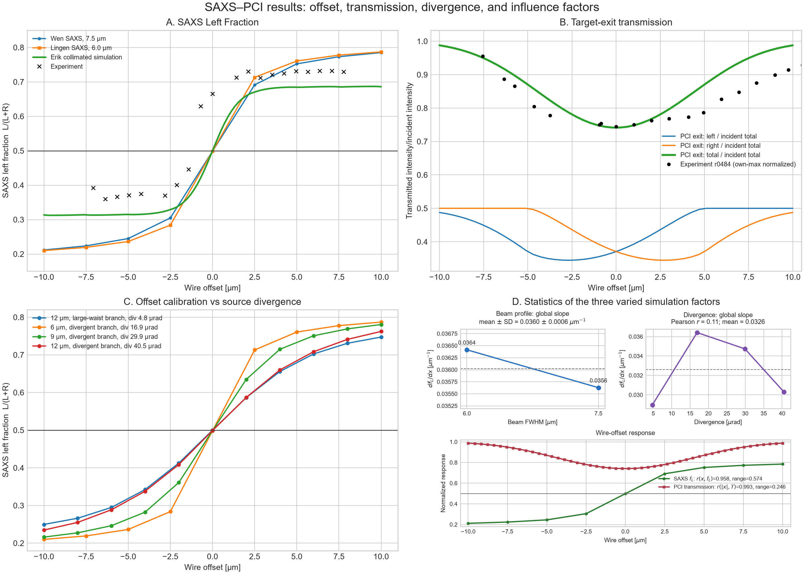
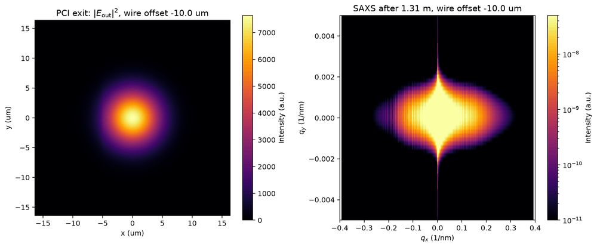

# SAXS–PCI results: unified summary and physical interpretation

This document consolidates the executed results from:

- [`clean_saxs_design.ipynb`](../SAXS_asymmetry/clean_saxs_design.ipynb)
- [`clean_pci_design.ipynb`](../SAXS_asymmetry/clean_pci_design.ipynb)
- [`SAXS_Asymmetry_Methods.ipynb`](../SAXS_asymmetry/SAXS_Asymmetry_Methods.ipynb)
- [`SAXS_PCI_Experimental_Comparison.ipynb`](../SAXS_asymmetry/SAXS_PCI_Experimental_Comparison.ipynb)
- [`realistic_profile_saxs_pci_design.ipynb`](../SAXS_asymmetry/realistic_profile_saxs_pci_design.ipynb)

The report uses the saved numerical tables and figures; it does not infer new
wave-propagation results. Raw intensities are simulation units unless a ratio is
explicitly normalized.

## Executive result



The principal conclusions are:

1. A centered Cu wire gives nearly equal SAXS sidebands: the clean 7.5 µm
   calculation gives $L/(L+R)=0.4986$ at zero offset.
2. Moving the wire across the curved Gaussian wavefront creates an odd,
   S-shaped SAXS response. For the clean 7.5 µm case the left fraction changes
   from 0.2116 at −10 µm to 0.7851 at +10 µm.
3. The target-exit PCI scan measures absorption and beam–wire overlap, not
   propagated phase contrast. Its total transmission is smallest when the wire
   overlaps the beam and approaches unity when the wire moves away.
4. The divergence study confirms that wavefront geometry affects the offset
   calibration, but the four saved cases also change the target spot size.
   Consequently, their slopes do **not** establish a one-variable monotonic law
   between divergence and asymmetry.
5. The experimental scans reproduce the sign, transition, and approximate
   plateau scale of the calculated SAXS response, but show a shifted midpoint,
   broader/asymmetric wings, and run-dependent profile asymmetry.
6. Replacing the ideal Gaussian illumination by the measured realistic target
   profile changes both the target-exit balance and the detailed SAXS lineout.
   The revised overview compares that result with the 6 µm methods profile,
   Erik's collimated calculation, the 6 µm `lg` archive, and the motor scan.

## 1. Common physics and definitions

All workflows use the same thin-object field model:

\[
E_{\rm exit}(x,y)=E_{\rm in}(x,y)
\exp\!\left[-\frac{\mu t(x,y)}{2}\right]
\exp[-ik\delta t(x,y)].
\]

Here $t(x,y)$ is the projected Cu-wire thickness. The first exponential
attenuates field amplitude; after taking $|E|^2$, it gives the
Beer–Lambert intensity factor $\exp(-\mu t)$. The second exponential is
the sample-induced phase delay. Propagating the complete complex exit field
lets the transmitted and scattered components interfere.

The active shared parameters are:

| Quantity | Value |
|---|---:|
| Photon energy | 8.2 keV |
| Wavelength | 0.151200 nm |
| Simulation grid | $4096\times4096$ |
| Sample-plane pixel | 8 nm |
| Sample-plane field of view | 32.768 µm |
| Gaussian waist to wire | 0.25 m |
| Gaussian target intensity FWHM | 7.5 µm in clean SAXS, clean PCI, and experimental comparison; 6 µm in the default methods calculation |
| Realistic-profile input | `RealisticProfile_10nm.tif`, interpolated to the 8 nm grid; zero incident phase |
| 7.5 µm case source radius $w_0$ | 1.988233 µm |
| 7.5 µm case Rayleigh range | 0.082136 m |
| Wavefront radius at wire | 0.276985 m |
| Wire | Cu cylinder, 5 µm radius |
| Wire projection sampling | 20 nm voxels |
| SAXS distance after wire | 1.31 m |
| Clean propagated-PCI distance after wire | 6.31 m |

The observables must not be mixed:

| Observable | Plane and operation | Physical meaning |
|---|---|---|
| PCI exit intensity | $|E_{\rm exit}|^2$, before free-space propagation | Absorption shadow and beam–wire overlap; phase cancels from intensity here |
| Propagated PCI | Angular-spectrum propagation, then $|E_D|^2$ | Near-field interference and phase-contrast fringes, subject to sampling limits |
| SAXS detector intensity | Single-FFT Fresnel propagation to 1.31 m | Momentum-space redistribution from the wire and curved incident wavefront |
| SAXS left fraction | Sideband integration on a central detector lineout | Signed pointing/offset proxy, robust to a common intensity scale |

For the Mark1300-compatible SAXS extraction, two central detector rows are
averaged and the direct-beam region is removed:

\[
L=\sum_{q_x<-0.10\,\mathrm{nm}^{-1}}I(q_x),\qquad
R=\sum_{q_x>+0.10\,\mathrm{nm}^{-1}}I(q_x),\qquad
f_L=\frac{L}{L+R}.
\]

On the 4096 grid, 522 pixels are excluded on each side of the center, giving
an effective cutoff of 0.100092 nm$^{-1}$. $f_L=0.5$ means equal integrated
sidebands; it does not mean that the detailed left and right profiles are
identical at every $q$.

## 2. Clean SAXS


The clean notebook propagated 41 offsets from −10 to +10 µm in 0.5 µm
steps. Selected values from the complete table are:

| Wire offset [µm] | Left $L$ [a.u.] | Right $R$ [a.u.] | $L/(L+R)$ |
|---:|---:|---:|---:|
| -10 | $3.2075\times10^{-6}$ | $1.1952\times10^{-5}$ | 0.2116 |
| -5 | $1.3764\times10^{-5}$ | $4.2461\times10^{-5}$ | 0.2448 |
| 0 | $2.0050\times10^{-5}$ | $2.0162\times10^{-5}$ | 0.4986 |
| +5 | $4.2298\times10^{-5}$ | $1.3927\times10^{-5}$ | 0.7523 |
| +10 | $1.1871\times10^{-5}$ | $3.2487\times10^{-6}$ | 0.7851 |

The full-range linear-fit slope is $+0.03811\ \mathrm{µm}^{-1}$, while the
local slope within $|x|\le2.5$ µm is much steeper,
$0.08318\ \mathrm{µm}^{-1}$. This difference is expected for a saturating
S-curve: a local calibration must state its fitted offset range.

**Physical meaning.** At zero offset the symmetric wire samples equal and
opposite parts of the wavefront, so the finite-$q_x$ sidebands balance. An
offset wire samples a different local phase gradient and clips/attenuates the
Gaussian envelope asymmetrically. Fresnel propagation converts that odd exit-
field component into unequal positive- and negative-$q_x$ intensity. At large
offset the response saturates because the wire leaves the beam core; both
$L+R$ and sensitivity eventually fall.

The complete numerical result is
[`DivSAXS_asymmetry_Mark1300_7p5um.dat`](../SAXS_asymmetry/outputs/saxs/tables/DivSAXS_asymmetry_Mark1300_7p5um.dat).
All 41 detector plots and float32 detector TIFFs are retained in
[`figures/Results_8nm/7.5um`](../SAXS_asymmetry/outputs/saxs/figures/Results_8nm/7.5um/)
and
[`detector_tiffs/Data_8nm/7.5um`](../SAXS_asymmetry/outputs/saxs/detector_tiffs/Data_8nm/7.5um/).

## 3. Clean PCI

The clean PCI notebook produces two distinct results.

### 3.1 Target-exit offset scan


The scan integrates $|E_{\rm exit}|^2$ on the two sample-plane half-planes,
normalizing each by the total incident intensity. Across −10 to +10 µm:

- total exit transmission ranges from 0.74162 near beam–wire overlap to
  0.98764 at the scan edges;
- the directional fraction $I_{\rm left}/(I_{\rm left}+I_{\rm right})$
  ranges from 0.4209 to 0.5791; and
- left and right exchange under offset reversal, as required by the symmetric
  ideal beam/wire model.

**Physical meaning.** This is an absorption/occlusion curve. It shows which
half of the Gaussian beam is blocked and how much total power survives the
wire. Because it is evaluated before propagation, the Cu phase term has unit
magnitude and cannot create detector fringes in this observable. The agreement
of the central transmission minimum with r0484 is meaningful; disagreement in
the two wings can reflect motor-zero calibration, a non-Gaussian beam,
background, wire geometry/material uncertainty, or experimental normalization.

The normalized and raw tables are
[`pci_exit_left_right_vs_offset.dat`](../SAXS_asymmetry/outputs/clean_pci/pci_exit_left_right_vs_offset.dat)
and
[`clean_pci_exit_left_right_raw_vs_offset.dat`](../SAXS_asymmetry/outputs/clean_pci/clean_pci_exit_left_right_raw_vs_offset.dat).

### 3.2 Propagated clean-PCI detector


The zero-offset exit field was propagated 6.31 m with the exact scalar
angular-spectrum transfer function on the unchanged 8 nm grid. The saved TIFF
is 4096×4096 float32:
[`clean_pci_detector_intensity.tif`](../SAXS_asymmetry/outputs/clean_pci/clean_pci_detector_intensity.tif).

The repeated edge structure in the plot is a numerical warning, not a physical
detector prediction. A 7.5 µm Gaussian propagated over 6.31 m is much wider
than the fixed 32.768 µm window. FFT angular-spectrum propagation assumes a
periodic transverse field, so energy wraps around the boundaries. The transfer
function is exact for the sampled field, but this saved discrete calculation is
not spatially converged. A larger field of view, padding, or a scaled-grid
propagator is required before quantitative interpretation of this detector
image.

## 4. SAXS asymmetry methods

### Method 1 — transverse wire offset


The 6 µm methods calculation, the archived Mark1300 curve, Erik's collimated
calculation, and the motor scan all have the same sign and transition through
approximately 0.5 near overlap. The current 7.5 µm methods table reproduces the
clean-SAXS fractions to within $4.3\times10^{-8}$, confirming that the two
notebooks use the same forward model and extraction for matched settings.

The historical 6 µm methods and archive results are not identical. Their
full-table slopes are 0.03750 and $0.03378\ \mathrm{µm}^{-1}$, respectively,
because their saved grids/configurations and offset coverage differ. Raw
sideband sums should not be compared across grid sizes; $L/(L+R)$ is the more
portable observable.

### Method 2 — divergence and spot-size dependence


| Case | Source $w_0$ [µm] | Nominal half-angle [µrad] | Global slope [µm$^{-1}$] |
|---|---:|---:|---:|
| 6 µm FWHM | 2.8467 | 16.91 | 0.03641 |
| 9 µm FWHM | 1.6102 | 29.89 | 0.03474 |
| 12 µm FWHM, small-waist branch | 1.1887 | 40.49 | 0.03030 |
| 12 µm FWHM, large-waist branch (“collimated”) | 10.1223 | 4.75 | 0.02896 |

**Physical meaning.** The comparison of the two 12 µm branches is the cleanest
curvature test: the strongly divergent branch has a modestly larger slope than
the large-waist branch. Across the 6, 9, and 12 µm cases, however, target spot
size changes with divergence. A tighter beam places more weight on the steep
wire/beam-overlap region, so the 6 µm case has the largest global slope even
though it does not have the largest nominal divergence. The saved study
therefore demonstrates coupled dependence on wavefront curvature and spatial
overlap, not divergence alone.

All plotted points are in
[`DivSAXS_divergence_vs_offset_Methods.dat`](../SAXS_asymmetry/outputs/methods/tables/DivSAXS_divergence_vs_offset_Methods.dat).

### Method 3 — PCI-exit/SAXS-detector gallery

The animation below uses the nine 7.5 µm experimental-comparison frames. The
left panel is sample-exit intensity; the right panel is the independently
propagated SAXS detector intensity after 1.31 m.



As the wire crosses the beam, the exit-plane absorption shadow moves through
the Gaussian envelope while the SAXS lobe transfers intensity from one
$q_x$ side to the other. These panels are related by their common incident
field and sample, but they are not the same image at different color scales.

The original methods animation (6 µm branch) is also retained as
[`PCI_after_sample_SAXS_detector_offset_scan.gif`](../SAXS_asymmetry/outputs/methods/movie/6um/PCI_after_sample_SAXS_detector_offset_scan.gif),
with its source TIFFs and nine PNG frames in
[`outputs/methods/movie/6um`](../SAXS_asymmetry/outputs/methods/movie/6um/).

## 5. SAXS–PCI experimental comparison

### Beam validation


The sampled source FWHM is 2.340970 µm versus 2.340966 µm expected; the sampled
pre-wire FWHM is 7.500001 µm versus 7.500000 µm expected. This validates the
Gaussian construction on the sample grid before sample interaction. It does
not by itself validate detector propagation or experimental beam shape.

### Aggregate experimental SAXS profiles

| Run | Integrated left fraction | Signal-weighted RMS asymmetry | Unweighted RMS | Fitted symmetry center [nm(^{-1})] |
|---|---:|---:|---:|---:|
| r0528 | 0.69674 | 0.19320 | 0.42769 | +0.001215 |
| r0534 | 0.49285 | 0.25132 | 0.41690 | +0.016059 |
| r0546 | 0.64225 | 0.11734 | 0.19229 | -0.002439 |

The weighted RMS is the preferred shape-asymmetry descriptor because weak,
background-subtracted bins can have a normalized asymmetry near ±1 while
carrying almost no signal. The unweighted values show that sensitivity.

The metrics also separate two notions of asymmetry. Run r0534 is nearly
balanced in total left/right flux (0.49285) but has the largest weighted shape
asymmetry and the largest fitted center displacement. Conversely, r0546 has a
large integrated left fraction but the smallest weighted RMS after centering.
Thus one scalar $L/(L+R)$ cannot distinguish a shifted profile, a gain/flux
imbalance, and a genuine mirrored-shape difference.

These files are aggregate cleaned profiles rather than individual shots, so
the metrics are deterministic descriptors, not uncertainty estimates or
confidence intervals.

### Transmission comparison


Simulation and experiment both have a minimum near the centered wire. The
experimental minimum is 0.74414 after normalization by its own maximum, close
to the calculated target-exit minimum. The experimental positive-offset wing
rises more slowly than the ideal symmetric Gaussian model. Since no absolute
intensity calibration is applied and each curve uses its own maximum, the
comparison tests shape and alignment rather than absolute detector efficiency.

The nine static paired PCI-exit/SAXS figures used in the GIF are available in
[`outputs/experimental_comparison/figures`](../SAXS_asymmetry/outputs/experimental_comparison/figures/).

<details>
<summary>Static offset-frame index</summary>

- [−10.0 µm](../SAXS_asymmetry/outputs/experimental_comparison/figures/01_exit_pci_and_saxs_offset_m10p0um.png)
- [−7.5 µm](../SAXS_asymmetry/outputs/experimental_comparison/figures/01_exit_pci_and_saxs_offset_m7p5um.png)
- [−5.0 µm](../SAXS_asymmetry/outputs/experimental_comparison/figures/01_exit_pci_and_saxs_offset_m5p0um.png)
- [−2.5 µm](../SAXS_asymmetry/outputs/experimental_comparison/figures/01_exit_pci_and_saxs_offset_m2p5um.png)
- [0.0 µm](../SAXS_asymmetry/outputs/experimental_comparison/figures/01_exit_pci_and_saxs_offset_p0p0um.png)
- [+2.5 µm](../SAXS_asymmetry/outputs/experimental_comparison/figures/01_exit_pci_and_saxs_offset_p2p5um.png)
- [+5.0 µm](../SAXS_asymmetry/outputs/experimental_comparison/figures/01_exit_pci_and_saxs_offset_p5p0um.png)
- [+7.5 µm](../SAXS_asymmetry/outputs/experimental_comparison/figures/01_exit_pci_and_saxs_offset_p7p5um.png)
- [+10.0 µm](../SAXS_asymmetry/outputs/experimental_comparison/figures/01_exit_pci_and_saxs_offset_p10p0um.png)

</details>

## 6. Realistic-profile SAXS and PCI comparison


This calculation replaces the Gaussian target illumination with the supplied
`RealisticProfile_10nm.tif` intensity. The profile is interpolated onto the
4096×4096, 8 nm grid and converted to field amplitude with
$|E|=\sqrt{I}$. Because no phase map accompanies the TIFF, the incident phase
at the target is set to zero. The four overview panels show:

1. realistic-profile PCI left, right, and total target-exit intensity;
2. realistic-profile and 7.5 µm Gaussian Mark1300 SAXS sideband intensities;
3. the SAXS left fraction for the realistic profile, the 7.5 µm Gaussian
   reference, Erik's collimated simulation, the 6 µm
   [`DivSAXS_asymmetry_Mark1300_6um_lg.dat`](../SAXS_asymmetry/outputs/saxs/tables/DivSAXS_asymmetry_Mark1300_6um_lg.dat)
   archive, and the experimental motor scan; and
4. signed-$q_x$ SAXS profiles for the centered realistic simulation and the
   centered 6 µm result generated by
   [`SAXS_Asymmetry_Methods.ipynb`](../SAXS_asymmetry/SAXS_Asymmetry_Methods.ipynb),
   together with experimental runs 528, 534, and 546.

The profile panel independently peak-normalizes every curve over
$0.10\le |q_x|\le0.30$ nm$^{-1}$ and shades the excluded direct-beam region.
It therefore compares SAXS shape versus momentum transfer, not absolute
intensity. The realistic and methods curves have similar broad envelopes but
different fine structure and wing levels. Those differences can arise from
the non-Gaussian incident amplitude, while the realistic input's assumed zero
phase remains an important limitation of the comparison.

The saved scan tables are
[`realistic_profile_pci_exit_left_right.dat`](../SAXS_asymmetry/outputs/realistic_profile/tables/realistic_profile_pci_exit_left_right.dat)
and
[`realistic_profile_saxs_left_right.dat`](../SAXS_asymmetry/outputs/realistic_profile/tables/realistic_profile_saxs_left_right.dat).

## 7. What can and cannot be concluded

Supported by the saved results:

- wire offset is a strong, signed control parameter for the SAXS sideband
  balance;
- the clean SAXS and matched methods implementation agree numerically;
- target-exit transmission is governed primarily by Gaussian beam–wire
  overlap and Cu absorption;
- the experimental data contain both global flux imbalance and detailed
  mirrored-profile asymmetry;
- wavefront curvature affects calibration, but spot size must be controlled to
  isolate its contribution; and
- the supplied realistic intensity profile can be propagated consistently and
  compared with Gaussian/methods results, but its missing incident phase map
  prevents a fully measured complex-field comparison.

Not yet supported:

- an absolute photon/count normalization of the simulated SAXS or PCI arrays;
- a one-parameter divergence law from the four mixed spot-size cases;
- quantitative use of the 6.31 m fixed-grid PCI detector image without a
  convergence study; or
- statistical uncertainty claims from the three aggregate experimental
  profiles.

For a controlled next comparison, keep the same complex exit field, grid,
field of view, propagation distance, detector sampling, wire offsets, and
extraction mask while changing only one physical or numerical parameter at a
time.

## 8. Reproducibility and complete result index

The compact overview, propagated-PCI preview, and 7.5 µm GIF can be regenerated
without rerunning the expensive propagation notebooks:

```powershell
.\.venv\Scripts\python.exe SAXS_asymmetry\generate_results_summary_assets.py
```

| Workflow | Primary figures | Numerical/full-resolution results |
|---|---|---|
| Clean SAXS | [41-offset overview](../SAXS_asymmetry/outputs/saxs/figures/Results_8nm/7.5um/SAXS_pointing_scan_with_asymmetry.png) | [7.5 µm table](../SAXS_asymmetry/outputs/saxs/tables/DivSAXS_asymmetry_Mark1300_7p5um.dat), [41 TIFFs](../SAXS_asymmetry/outputs/saxs/detector_tiffs/Data_8nm/7.5um/) |
| Clean PCI | [cross-comparison plot](../SAXS_asymmetry/outputs/clean_pci/clean_pci_saxs_mark1300_left_right_vs_offset.png), [detector preview](saxs_pci_results_assets/clean_pci_detector.png) | [normalized scan](../SAXS_asymmetry/outputs/clean_pci/pci_exit_left_right_vs_offset.dat), [raw scan](../SAXS_asymmetry/outputs/clean_pci/clean_pci_exit_left_right_raw_vs_offset.dat), [detector TIFF](../SAXS_asymmetry/outputs/clean_pci/clean_pci_detector_intensity.tif) |
| Asymmetry methods | [offset scan](../SAXS_asymmetry/outputs/methods/figures/01_offset_scan.png), [divergence scan](../SAXS_asymmetry/outputs/methods/figures/05_divergence_scan.png), [GIF](../SAXS_asymmetry/outputs/methods/movie/6um/PCI_after_sample_SAXS_detector_offset_scan.gif) | [6 µm table](../SAXS_asymmetry/outputs/methods/tables/DivSAXS_asymmetry_Methods_6um.dat), [7.5 µm table](../SAXS_asymmetry/outputs/methods/tables/DivSAXS_asymmetry_Methods_7p5um.dat), [divergence table](../SAXS_asymmetry/outputs/methods/tables/DivSAXS_divergence_vs_offset_Methods.dat), [movie TIFFs/frames](../SAXS_asymmetry/outputs/methods/movie/6um/) |
| Experimental comparison | [beam check](../SAXS_asymmetry/outputs/experimental_comparison/figures/00_gaussian_beam_source_and_target_profiles.png), [transmission](../SAXS_asymmetry/outputs/experimental_comparison/figures/04_exit_transmission.png), [7.5 µm GIF](saxs_pci_results_assets/saxs_pci_experimental_offset_scan.gif) | [nine paired static frames](../SAXS_asymmetry/outputs/experimental_comparison/figures/), [experimental inputs](../SAXS_asymmetry/inputs/experimental/) |
| Realistic profile | [incident profile](../SAXS_asymmetry/outputs/realistic_profile/figures/00_realistic_incident_profile.png), [PCI/SAXS overview](../SAXS_asymmetry/outputs/realistic_profile/figures/01_realistic_pci_saxs_left_right.png), [experimental profile matches](../SAXS_asymmetry/outputs/realistic_profile/figures/02_realistic_saxs_vs_runs_528_534_546.png) | [PCI scan](../SAXS_asymmetry/outputs/realistic_profile/tables/realistic_profile_pci_exit_left_right.dat), [SAXS scan](../SAXS_asymmetry/outputs/realistic_profile/tables/realistic_profile_saxs_left_right.dat), [best-match table](../SAXS_asymmetry/outputs/realistic_profile/tables/realistic_profile_experimental_best_matches.dat), [41 detector TIFFs](../SAXS_asymmetry/outputs/realistic_profile/detector_tiffs/) |
