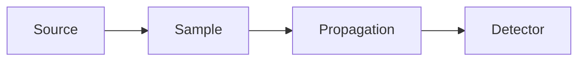

# Documentation guide

The project documentation is built from Markdown with
[Zensical](https://zensical.org/). Site metadata, navigation, theme features,
and Markdown extensions are configured in `zensical.toml`.

## Preview changes

Install the locked development dependency group once:

```powershell
uv sync --locked --only-group dev
```

Start the live preview server:

```powershell
uv run zensical serve
```

Before submitting documentation changes, create a clean production build:

```powershell
uv run zensical build --clean
```

## Add or rename a page

1. Add the Markdown file under `docs/`.
2. Give the page one descriptive level-one heading.
3. Add the page to the `nav` list in `zensical.toml`.
4. Use relative links for other pages in `docs/`.
5. Put site assets under `docs/` so Zensical can copy them into the build.
6. Run a clean build and resolve every missing-page or missing-asset warning.

## Authoring conventions

- Follow a logical heading hierarchy without skipping levels.
- Use descriptive link text that makes sense outside its surrounding sentence.
- Give every informative image concise alternative text.
- Specify a language on fenced code blocks, such as `python`, `text`, or
  `powershell`.
- Use tables only for tabular data.
- Keep generated output and large simulation artifacts out of `docs/` unless
  they are intentionally published.

## Scientific notation

Inline expressions use dollar delimiters, for example
`$k = 2\pi/\lambda$`. Display equations use a separate block:

```text
$$
E_D = \mathcal{F}^{-1}\{\mathcal{F}[E_0]H\}
$$
```

MathJax is loaded for the whole site through `docs/javascripts/mathjax.js`.

## Diagrams

Mermaid diagrams are supported by the configured fenced-code extension:

````markdown

````

## Deployment

The `Documentation` GitHub Actions workflow builds the site with Zensical,
uploads `site/` as the Pages artifact, and deploys it to GitHub Pages. GitHub
Pages must use **GitHub Actions** as its publishing source.
