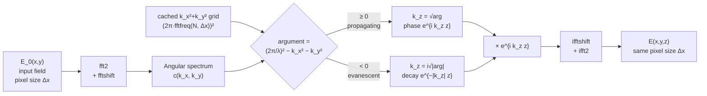
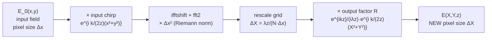
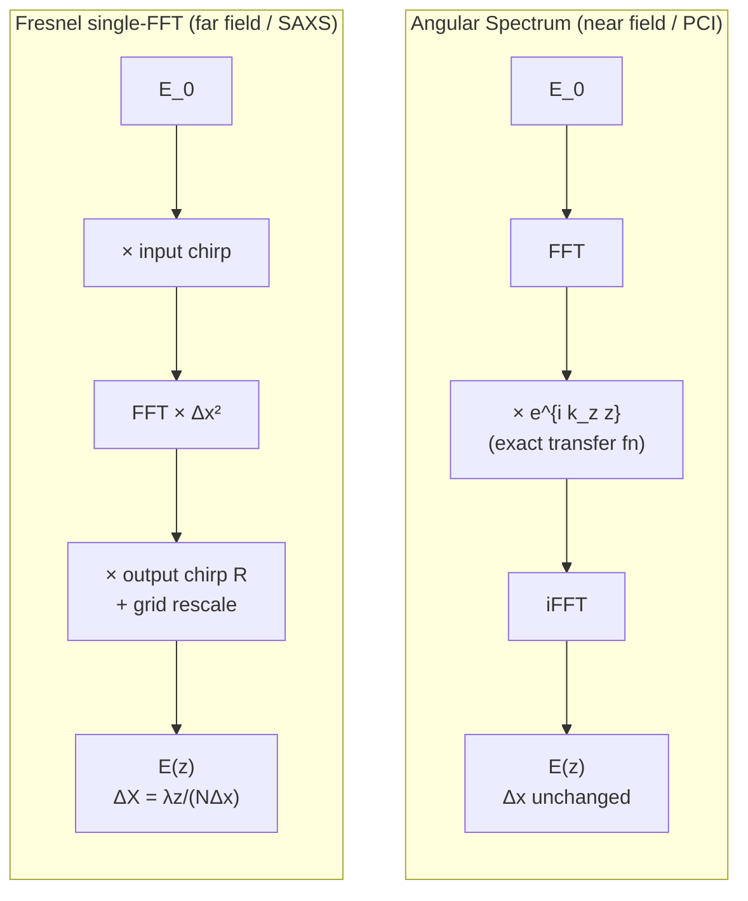
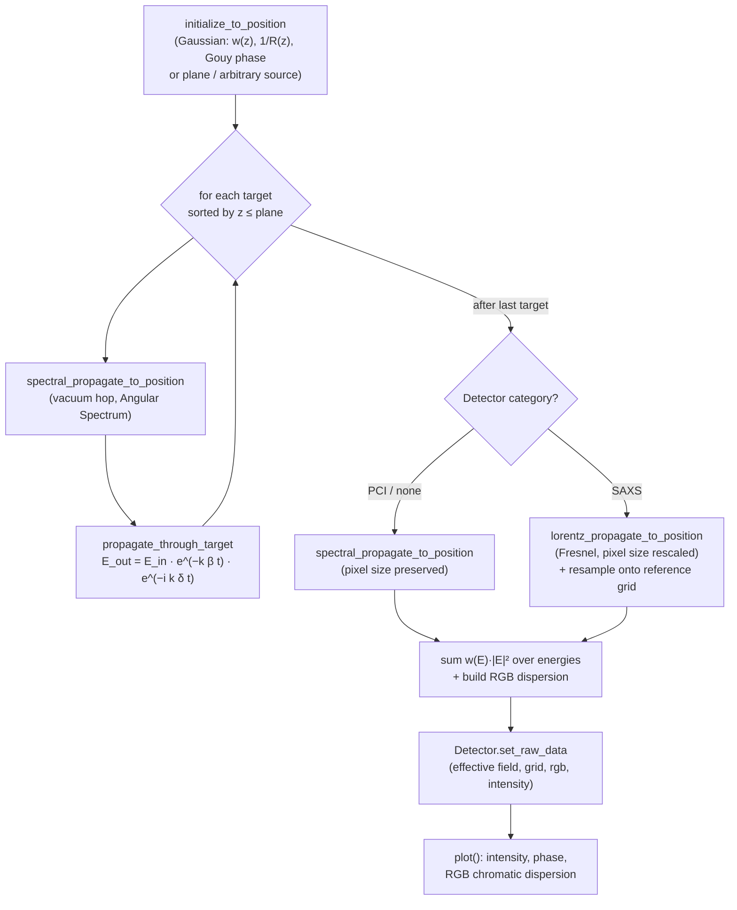
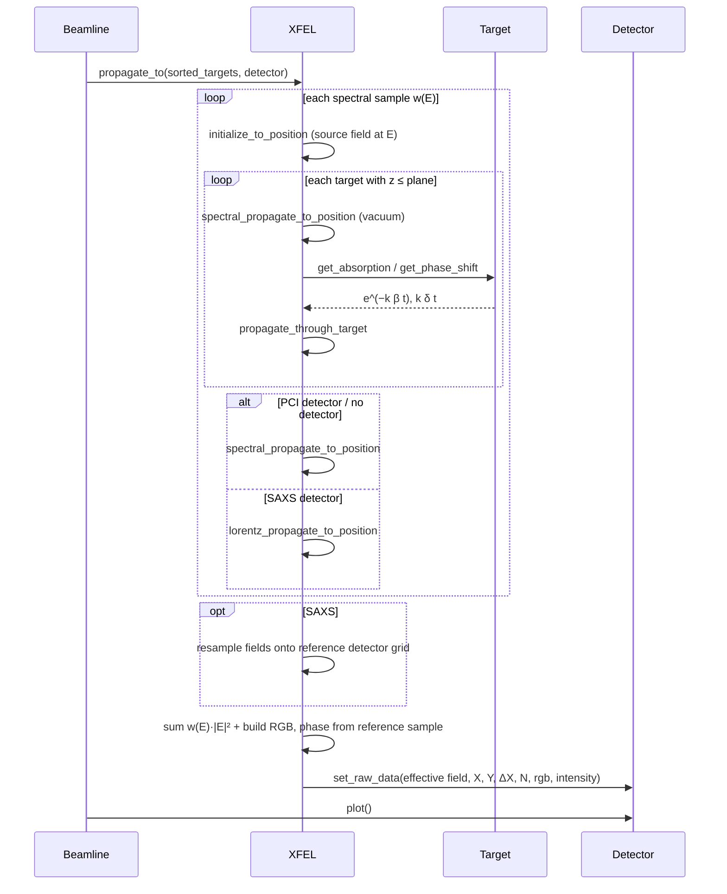

# HRXP Propagator Math

This document explains the wave-optics propagators implemented in
`SAXS_asymmetry/PCI.py` (HRXP, the Hibef ReLaX XFEL Propagator), the physics
they encode, and how they map onto the source code. All quantities use the
module unit system: **length in nanometers** (`nm = 1`) and **energy in keV**
(convenience constants `m`, `um`, `mm`, `cm`, `eV` are provided).

!!! warning "Source availability"

    The referenced `SAXS_asymmetry/PCI.py` implementation is not present in
    this checkout. This page preserves the documented equations and intended
    behavior, but implementation-specific claims cannot be verified here.

## Rayleigh–Sommerfeld: real-space foundation

**Rayleigh–Sommerfeld propagation is the real-space form of the same scalar
free-space propagation described by angular spectrum in Fourier space.**
Let $E_0(x',y')$ be the known field over the plane $z=0$. With time dependence
$e^{-i\omega t}$, wavelength $\lambda$, and $k=2\pi/\lambda$, the outgoing
solution in the homogeneous, source-free half-space $z>0$ is

$$
\boxed{
E(X,Y,z)=\iint_{\mathbb R^2}E_0(x',y')\,
h_{\mathrm{RS}}(X-x',Y-y';z)\,\mathrm dx'\,\mathrm dy'
= (E_0*h_{\mathrm{RS}})(X,Y)
}
$$

where $R=\sqrt{(X-x')^2+(Y-y')^2+z^2}$ and the exact Rayleigh–Sommerfeld I
kernel is

$$
\begin{aligned}
h_{\mathrm{RS}}
&=-\frac{1}{2\pi}\frac{\partial}{\partial z}
  \left(\frac{e^{ikR}}{R}\right)\\
&=\frac{z\,e^{ikR}}{2\pi R^3}(1-ikR)
=\frac{1}{i\lambda}\frac{z}{R}\frac{e^{ikR}}{R}
  \left(1+\frac{i}{kR}\right).
\end{aligned}
$$

This derivative form follows the scalar diffraction formulation in
[Cubillos and Jimenez, section 2](https://arxiv.org/pdf/2111.06951).
Each input position contributes a complex amplitude at the observation point;
these amplitudes interfere before intensity is calculated as $I=|E|^2$.
The factor $z/R$ is the obliquity factor. For $kR\gg1$, dropping $i/(kR)$ gives
the commonly used spherical-wave kernel $z e^{ikR}/(i\lambda R^2)$; that
simplification is distinct from the paraxial approximation.

### Equivalent Fourier-space form

Use the transverse Fourier convention
$\mathcal F[f](k_x,k_y)=\iint f(x,y)e^{-i(k_xx+k_yy)}\,\mathrm dx\,\mathrm dy$,
with inverse normalization $1/(2\pi)^2$. Then

$$
\mathcal F[h_{\mathrm{RS}}](k_x,k_y)=e^{ik_z z},
\qquad
k_z=
\begin{cases}
\sqrt{k^2-k_x^2-k_y^2}, & k_x^2+k_y^2\le k^2,\\
i\sqrt{k_x^2+k_y^2-k^2}, & k_x^2+k_y^2>k^2.
\end{cases}
$$

Consequently, the convolution theorem gives

$$
\underbrace{E_0*h_{\mathrm{RS}}}_{\text{Rayleigh–Sommerfeld: real space}}
=\underbrace{\mathcal F^{-1}\!\left[\mathcal F[E_0]e^{ik_z z}\right]}
_{\text{angular spectrum: Fourier space}}.
$$

Both forms are exact within this scalar boundary-value problem, including
evanescent decay, and apply in the near and far field. Their equivalence is
explained in [TU Delft's diffraction chapter](https://interactivetextbooks.tudelft.nl/interactive-optics/content/Chap6_Diffraction/DiffractiveOptics_2022_01Clean.html#rayleigh-sommerfeld-diffraction-integral).

### From Rayleigh–Sommerfeld to Fresnel and Fraunhofer

Writing $\rho^2=(X-x')^2+(Y-y')^2$, the paraxial expansion
$R\simeq z+\rho^2/(2z)$, together with $z/R^2\simeq1/z$ and $kR\gg1$, gives

$$
h_{\mathrm F}(\rho;z)=\frac{e^{ikz}}{i\lambda z}
\exp\!\left(\frac{ik\rho^2}{2z}\right).
$$

The neglected phase must be small over the contributing region:
$k\rho^4/(8z^3)\ll1$. Fraunhofer makes the further approximation of neglecting
the input quadratic phase when $k(x'^2+y'^2)/(2z)\ll1$ over the illuminated
support. This is the approximation hierarchy described in
[TU Delft's Fresnel and Fraunhofer derivation](https://interactivetextbooks.tudelft.nl/interactive-optics/content/Chap6_Diffraction/DiffractiveOptics_2022_01Clean.html#fresnel-and-fraunhofer-approximations).

| Description | Representation | Approximation |
| --- | --- | --- |
| Rayleigh–Sommerfeld I | Real-space convolution | Exact scalar half-space solution |
| Angular spectrum | Fourier-space multiplication | Equivalent exact scalar solution |
| Fresnel | Quadratic-phase integral; can use an FFT | Paraxial |
| Fraunhofer | Fourier transform of the input field with detector scaling | Further far-field limit of Fresnel |

In `PCI.py`, `spectral_propagate_to_position()` evaluates the angular-spectrum
form; there is no separate direct Rayleigh–Sommerfeld integrator. Continuum
equivalence does not guarantee identical sampled results: a real-space sum
requires area weights and adequate kernel sampling, while FFT propagation
requires adequate sampling and window size to control periodic wraparound.

---

## 1. Conventions and base quantities

The field is a scalar, monochromatic, complex wavefield in a transverse plane,
using the phasor convention $E(r,z)\,e^{-i\omega t}$:

$$E(x, y) = E_r(x, y) + i\,E_i(x, y) = A(x,y)\, e^{i\phi(x,y)}$$

stored as `self._realPart` and `self._imagPart`.

| Symbol | Meaning | Code |
| --- | --- | --- |
| $k$ | wavenumber $2\pi/\lambda$ | `get_k()` → `2π · E[keV] / HC_KEV_NM` |
| $\lambda$ | wavelength | `get_lambda()` → `2π/k` |
| $\delta$ | refractive index decrement | `get_n_refraction_delta()` |
| $\beta$ | absorption index | `get_n_refraction_beta()` |
| $t(x,y)$ | projected target thickness | `_get_projection()` |

The named constant `HC_KEV_NM = 1.239842` is $h c$ in keV·nm, so
$\lambda[\text{nm}] = 1.239842 / E[\text{keV}]$ and
$k = 2\pi E / 1.239842 \approx 5.0677\,E$ per nm.

Under the $e^{-i\omega t}$ convention the complex refractive index is

$$n = 1 - \delta + i\beta$$

with

$$\delta = C \; N_a\, \rho\, \frac{Z}{A}\, r_e \, \frac{\lambda^2}{2\pi},
\qquad
\beta = \frac{\mu_1\,\rho}{E^{\mu_2}}.$$

The prefactor $C$ is the `dispersion_correction` constructor parameter of
`Material` (default `0.933386`, the legacy empirical correction that matches
Henke optical constants; set it to `1.0` for the uncorrected free-electron /
Thomson model). The $\beta$ power law is empirical (fit for copper in `Cu`)
and must not be extrapolated across absorption edges. Photon energies are
validated to be positive and finite; invalid input raises `ValueError`.

---

## 2. Interaction with a target (thin / projection approximation)

A target is treated as an infinitely thin phase-and-amplitude screen at its
$z$ position. A target may stack several material regions; phase delays and
optical depths add linearly before the exponentials are formed:

$$E_{\text{out}}(x,y) = E_{\text{in}}(x,y)\;
\underbrace{e^{-k \beta\, t(x,y)}}_{\text{amplitude transmission}}\;
\underbrace{e^{-i\,k \delta\, t(x,y)}}_{\text{phase shift}}$$

### Amplitude (absorption)
`Material._get_mu()` returns the Beer–Lambert **intensity** attenuation
coefficient in nm⁻¹:

$$\mu = 2 k \beta$$

`Target.get_absorption()` sums the optical depths of all materials and returns
the **field** transmission (the factor $\tfrac12$ maps intensity attenuation to
amplitude attenuation — intensity goes as $e^{-\mu t}$, amplitude as
$e^{-\mu t/2} = e^{-k\beta t}$):

$$T_{\text{field}} = \exp\Big[-\tfrac12 \textstyle\sum_i \mu_i\, t_i(x,y)\Big]$$

### Phase
`Material._get_phase_shift()` returns the per-length phase coefficient
$k\delta$ in nm⁻¹; `Target.get_phase_shift()` multiplies it by the projected
thickness and sums over materials:

$$\Delta\phi(x,y) = \sum_i k\,\delta_i\, t_i(x,y)$$

### In code (`propagate_through_target`)
The transmission is applied complex-natively — no manual phase decomposition
or wrapping (the complex exponential already represents phase modulo $2\pi$):

```python
absorption  = self._interpolate_target2beam(target.get_absorption(E), target)
phase_shift = self._interpolate_target2beam(target.get_phase_shift(E), target)
output = field * absorption * np.exp(-1j * phase_shift)
```

Diagnostics `intensity_beforetarget`, `phase_beforetarget`,
`intensity_aftertarget`, and `phase_aftertarget` are stored on the XFEL object.

### Target grid → beam grid
`_interpolate_target2beam()` resamples the target grid (voxel size) onto the
beam grid (pixel size) with a `RectBivariateSpline` (order `min(3, N-1)`),
then applies two safeguards:

- negative interpolated thickness (cubic-spline undershoot at sharp material
  boundaries) is clipped to zero — negative path length would imply gain;
- pixels outside the finite target domain are set to exactly zero, preventing
  spline extrapolation from creating nonphysical material around the target.

### The `wire` target
`wire._get_projection()` evaluates the analytic chord of an infinite cylinder,
$t(s) = 2\sqrt{R^2 - s^2}$, instead of voxelizing a 3-D volume — memory grows
as $N^2$ rather than $N^3$ and no axial voxelization error is introduced.
In-plane rotation and transverse offset are applied as 2-D resampling
operations (`scipy.ndimage.rotate` / `shift`).

---

## 3. Angular Spectrum propagator (exact; used for PCI)

Implemented in `spectral_propagate_to_position()`. Used for **PCI** and for the
target-to-target hops. This is the exact solution of the Helmholtz equation in
free space and **preserves the pixel size**.

### Derivation
Decompose the field into plane waves (the angular spectrum) via 2D Fourier
transform:

$$\tilde{E}_0(k_x, k_y) = \mathcal{F}\{E_0(x,y)\}$$

Each plane-wave component propagates a distance $z$ by acquiring a phase
$e^{i k_z z}$, where the dispersion relation fixes $k_z$:

$$k_z = \sqrt{\left(\frac{2\pi}{\lambda}\right)^2 - k_x^2 - k_y^2}$$

The propagated field is the inverse transform:

$$\boxed{\,E(x,y,z) = \mathcal{F}^{-1}\!\left\{ \mathcal{F}\{E_0\}\;
e^{\,i k_z z} \right\}\,}$$

### Evanescent modes
When $k_x^2 + k_y^2 > (2\pi/\lambda)^2$ the argument under the root is negative
and $k_z$ becomes **imaginary**, giving exponential decay $e^{-|k_z| z}$. The
code handles both branches explicitly:

```python
c = fftshift(fft2(field_in))
argument = (2*np.pi/Lambda)**2 - self._get_angular_frequency_squared()
tmp = np.sqrt(np.abs(argument))
kz  = np.where(argument >= 0, tmp, 1j*tmp)   # propagating vs evanescent
E_new = ifft2(ifftshift(c * np.exp(1j * kz * Z)))
```

`_get_angular_frequency_squared()` caches the geometry-only grid
$k_x^2 + k_y^2$ (built from `2π·fftfreq(N, Δx)`); wavelength and distance stay
live inputs so the physical transfer function is exact for every spectral
sample. The cache is invalidated whenever the image scale is redefined.
`Z == 0` returns a copy of the input immediately.

### Properties
- **Exact** (no paraxial approximation) — valid in near and far field.
- **Pixel size unchanged**: output sampling = input sampling (also exported as
  `new_x_plot` / `new_pixel_size`, in µm).
- Best for short propagation where the beam stays inside the window — ideal for
  phase-contrast fringe formation.

### Algorithm diagram



The transfer function $H = e^{i k_z z}$ is a **pure phase** for propagating
modes (energy-conserving) and a **real decay** for evanescent modes. The grid
spacing never changes, so successive hops compose cleanly.

---

## 4. Fresnel single-FFT propagator (paraxial, magnifying)

Implemented in `lorentz_propagate_to_position()`. Used for **SAXS** (detector
far from the last target). This is the paraxial (Fresnel) approximation
evaluated with a **single** Fourier transform, which **rescales the pixel size**.

### Derivation
The Fresnel diffraction integral is

$$E(X,Y,z) = \frac{e^{ikz}}{i\lambda z}
\iint E_0(x,y)\,
e^{\,i\frac{k}{2z}\left[(X-x)^2 + (Y-y)^2\right]}\, dx\, dy.$$

Expanding the quadratic and separating terms that do/do not depend on the
integration variables gives the **single-FFT** form:

$$E(X,Y,z) = \frac{e^{ikz}}{i\lambda z}\,
e^{\,i\frac{k}{2z}(X^2+Y^2)}\;
\mathcal{F}\!\left\{ E_0(x,y)\, e^{\,i\frac{k}{2z}(x^2+y^2)} \right\}$$

The input chirp $e^{ik(x^2+y^2)/2z}$ is applied, then one FFT, then the output
quadratic phase factor $R$. The discrete sum approximates the continuous
integral, so the FFT is multiplied by the Riemann-sum area element
$\Delta x^2$.

### Pixel-size rescaling
Because the FFT maps the input plane directly to the diffraction plane, the
output pixel size is set by the transform geometry:

$$\Delta X = \frac{2\pi z}{k\,N\,\Delta x} = \frac{\lambda z}{N\,\Delta x}$$

In code:
```python
new_pixel_size = Z * 2*np.pi / (k * old_pixel_number * old_pixel_size)
E = old_pixel_size**2 * fft2(                                    # dx² norm
        ifftshift(E * np.exp(1j*k/(2*Z)*(self._x**2 + self._y**2))))
X, Y = self._define_image_scale(pixel_size=new_pixel_size, reset=False)
R = np.exp(1j*k*Z)/(1j*Lambda*Z) * np.exp(1j*k/(2*Z)*(X**2 + Y**2))
E = R * fftshift(E)
```

The rescaled grid is stored as `_propagated_x` / `_propagated_y` /
`_propagated_pixel_size` (and exported as `new_x_plot` / `new_pixel_size`, in
µm). With `reset=True` the object's own image scale is redefined to the new
pixel size; `Z == 0` returns the input unchanged on the unchanged grid.

### Properties
- **Paraxial** (small-angle) approximation — valid in the Fresnel regime and
  its far-field limit when the neglected phase is small.
- **Pixel size changes** with $z$ — magnifying coordinate system.
- Efficient single FFT for large detector distances.

### Algorithm diagram



Unlike the angular-spectrum method, the single FFT maps the **input plane**
directly to the **diffraction plane**, so the output coordinates $X, Y$ are
stretched by the factor $\lambda z/(N\Delta x)$. The two quadratic-phase
("chirp") factors bracket the transform: one before (input curvature) and one
after (output curvature).

---

## 5. Choosing a propagator

| Regime | Propagator | Method | Pixel size | Code |
| --- | --- | --- | --- | --- |
| General scalar free space | Rayleigh–Sommerfeld I | $E_0*h_{\mathrm{RS}}$ | chosen observation grid | Real-space foundation; no separate integrator |
| Near field / PCI | Angular Spectrum | $\mathcal{F}^{-1}[\mathcal{F}E_0\,e^{ik_z z}]$ | preserved | `spectral_propagate_to_position` |
| Far field / SAXS | Fresnel single-FFT | chirp · FFT · chirp | rescaled | `lorentz_propagate_to_position` |

`propagate_to()` selects automatically: PCI detectors (or a plain position with
no detector) use the spectral propagator for the final hop; SAXS detectors use
the Lorentz/Fresnel propagator. Both paths support a finite spectral
bandwidth; because the Fresnel output grid is wavelength-dependent, SAXS
spectral samples are resampled onto a common detector grid before they are
combined (section 6).

### Side-by-side comparison



| | Angular Spectrum | Fresnel single-FFT |
| --- | --- | --- |
| FFTs | 2 (forward + inverse) | 1 (forward only) |
| Approximation | none (exact) | paraxial |
| Transfer function | $e^{i k_z z}$ | input + output chirps |
| Output grid | same $\Delta x$ | rescaled $\Delta X$ |
| Evanescent waves | yes | no |
| Use case | PCI, target hops | SAXS far field |

---

## 6. Polychromatic (bandwidth) propagation

Distinct photon-energy samples are **mutually incoherent**: their intensities,
never their complex amplitudes, are weighted and summed.

`_spectral_samples()` builds the energy comb. The bandwidth parameter is
interpreted as the FWHM of a Gaussian energy distribution; samples are placed
at spacing `photon_energy_bandwidth_sample_width` covering ±2·FWHM (which
captures essentially all Gaussian weight), with normalized weights

$$w(E) = \exp\!\left[-4\ln 2\,\frac{(E-E_0)^2}{\text{FWHM}^2}\right],
\qquad \sum_E w(E) = 1.$$

A zero bandwidth, zero sample width, or a sample width ≥ 4·FWHM degenerates to
a single monochromatic sample.

`propagate_to()` then, for each sample energy:

1. runs the full source → targets → detector chain (section 7) — both $\delta$
   and the diffraction angles scale with $\lambda$, so colors focus and
   diffract differently;
2. for **SAXS**, resamples the propagated complex field from that energy's
   wavelength-dependent Fresnel grid onto the detector grid of the reference
   sample (the one nearest the center energy) via `_resample_complex_field()`
   (spline interpolation of real and imaginary parts, zero outside the source
   domain). Summing equal array indices without this step would mix different
   physical detector positions and create artificial chromatic structure;
3. accumulates `w(E) · |E_field|²` into the total intensity, and into RGB
   channels using per-energy red→green→blue ramp weights to render chromatic
   dispersion (each channel finally normalized to its own maximum).

The returned effective field is $\sqrt{I_{\text{total}}}\,e^{i\phi_{\text{ref}}}$ —
physical summed intensity with the reference sample's phase borrowed for
compatibility with the legacy complex-field API. Energies are processed
serially; the module-level `parallel` flag can enable multi-threaded SciPy
FFTs (`workers=`), replacing the old `multiprocessing.Pool` approach.

---

## 7. Full propagation pipeline

Sources: `gaussian_XFEL` (fundamental paraxial Gaussian, unit integrated
power), `plane_XFEL` (unit-amplitude plane wave), or `arbitrary_XFEL`
(user-supplied source-plane field, advanced by angular-spectrum propagation).
For the Gaussian, `initialize_to_position()` evaluates $w(z)$ (1/e field
radius), the inverse curvature $1/R(z) = z/(z^2+z_R^2)$ (finite at the waist),
Gouy phase $\arctan(z/z_R)$, and $z_R = \pi w_0^2/\lambda$.



Targets are kept sorted by $z$ (`Beamline._sorted_targets`); targets beyond
the requested plane are skipped. Positions and distances are validated
non-negative.

### Sequence of a `Beamline.propagate_XFEL_to(detector)` call



---

## 8. Quick reference — equations to code

| Physics | Equation | Function |
| --- | --- | --- |
| Wavenumber | $k = 2\pi E / hc$, $hc = 1.239842$ keV·nm | `get_k` |
| Phase decrement | $\delta = C\, N_a \rho \frac{Z}{A} r_e \frac{\lambda^2}{2\pi}$ | `get_n_refraction_delta` |
| Absorption index | $\beta = \mu_1 \rho / E^{\mu_2}$ | `get_n_refraction_beta` |
| Phase coefficient | $k\,\delta$ | `Material._get_phase_shift` |
| Intensity attenuation | $\mu = 2 k \beta$ | `Material._get_mu` |
| Target phase | $\Delta\phi = \sum_i k\,\delta_i\, t_i$ | `Target.get_phase_shift` |
| Target amplitude | $T = e^{-\frac12\sum_i \mu_i t_i}$ | `Target.get_absorption` |
| Wire projection | $t(s) = 2\sqrt{R^2 - s^2}$ | `wire._get_projection` |
| Rayleigh–Sommerfeld I | $E = E_0*h_{\mathrm{RS}}$ | Equivalent continuum formulation of `spectral_propagate_to_position`; no direct integrator |
| Angular spectrum | $E = \mathcal{F}^{-1}[\mathcal{F}E_0\, e^{ik_z z}]$ | `spectral_propagate_to_position` |
| Fresnel single-FFT | $E = \frac{e^{ikz}}{i\lambda z} e^{i\frac{k}{2z}R^2}\,\Delta x^2\,\mathcal{F}[E_0 e^{i\frac{k}{2z}r^2}]$ | `lorentz_propagate_to_position` |
| Gaussian beam | $w(z),\ 1/R(z)=\frac{z}{z^2+z_R^2},\ z_R=\pi w_0^2/\lambda$, Gouy $\arctan(z/z_R)$ | `gaussian_XFEL.initialize_to_position` |
| Spectral weights | $w(E) = e^{-4\ln 2\,(E-E_0)^2/\text{FWHM}^2}$ | `_spectral_samples` |
